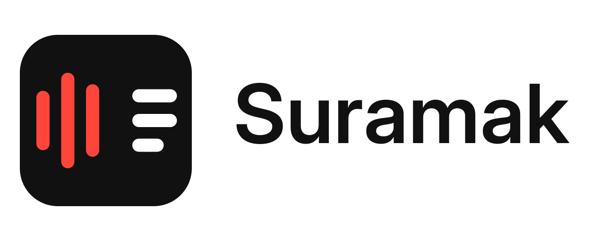
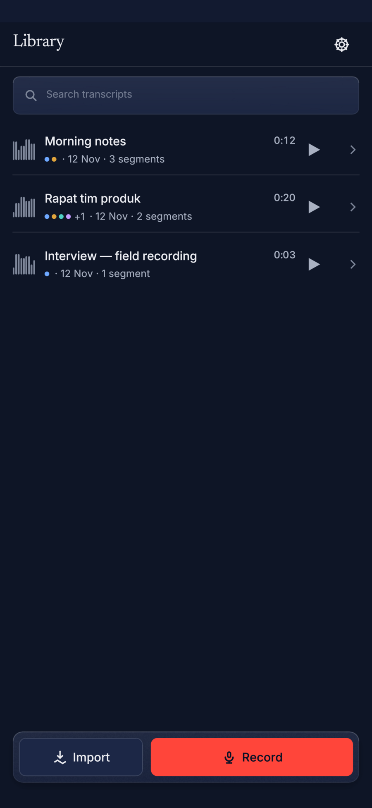
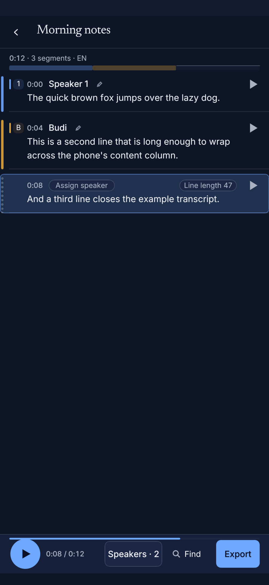

# Suramak

<p align="center"></p>

<p align="center">
  <a href="https://github.com/LoLyeah/suramak/actions/workflows/ci.yml"></a>
  <a href="https://github.com/LoLyeah/suramak/releases/latest"></a>
</p>

Local-first transcription for desktop and Android — record, transcribe, edit and search spoken audio entirely on your device.

Native Rust (`egui` + `wgpu`), no webview and no `ffmpeg`. Free and open source under GPL-3.0-or-later, with no account, no subscription and no telemetry.

<p align="center">
  
  &nbsp;&nbsp;
  
</p>
<p align="center"><em>The Android Library, and speaker tagging in the editor.</em></p>

## Features

- **On-device speech-to-text** with `whisper.cpp` — English and Indonesian are first-class, and any Whisper language code works. Optional faster English engines (Parakeet, and Apple `SpeechTranscriber` on macOS 26+).
- **Files, video and voice notes** — audio, `mp4`/`mov`/`m4v`/`mkv`/`webm`, and Opus voice notes, decoded natively (`libopus` built in). No media converter to install.
- **Recording that handles real rooms** — mix several inputs (two mics, or mic + system audio) into one drift-corrected recording; on macOS, capture a single app's audio. A provisional transcript grows live and is replaced by the full-file pass on stop.
- **A queue that survives the OS** — an interrupted transcription resumes at the last committed segment, producing output byte-equal to an uninterrupted run.
- **A real editor** — undoable split/merge, word-level highlighting during playback, find-with-seek, glossaries, and line-length advisories.
- **Speakers** — on-device diarization on desktop (session-local clusters, never identity), plus manual tagging everywhere: rename, colour, merge, split, assign per turn.
- **Search everything you've said** — full-text search across the whole library (SQLite FTS5, ~16 ms p95 over 8,000 segments), with mini-waveforms and speaker pips.
- **Exports** — SRT, VTT, ASS, Markdown, TXT and JSON, optionally with speaker labels, plus quote-card PNGs.
- **Optional polish** through your own OpenAI-compatible endpoint, text-only or audio-aware, reviewed side by side. The app is fully usable without it.
- **Android that stays out of the way** — share a voice note from any chat app and the transcript comes back in a paged notification; foreground recording with notification controls and a Quick Settings tile. No `NotificationListener`, no media scraping.

## Download

Builds for every platform live on the [releases page](https://github.com/LoLyeah/suramak/releases/latest).

| Platform | Asset | Notes |
| :--- | :--- | :--- |
| **macOS 13+** (Apple Silicon) | `Suramak-v<version>-macos-arm64.dmg` / `.zip` | Ad-hoc signed — right-click → Open on first launch. In-app updates. |
| **Windows 11** (x86_64) | `suramak-v<version>-windows-x86_64.zip` | Portable app + CLI, no installer. Unsigned: SmartScreen → *More info* → *Run anyway*. |
| **Linux** (x86_64) | `suramak-v<version>-linux-x86_64.tar.gz` | Run `./suramak`; a `.desktop` entry is included. |
| **Android 10+** (arm64-v8a) | `suramak-<version>-android-arm64-v8a.apk` | Signed APK. |

## Install

- **macOS** — open the `.dmg`, drag **Suramak** to `/Applications`, then right-click the app and choose **Open** once.
- **Windows** — extract the zip anywhere and run `suramak.exe` (`suramak-cli.exe` sits beside it).
- **Linux** — `tar -xzf suramak-v*-linux-x86_64.tar.gz && ./suramak`.
- **Android** — open the APK on the device and allow installs from this source when prompted.

Speech models are not bundled. The app downloads them on first use — resumable, checksum-verified, and removable from Settings.

## Quick start (CLI)

```sh
cargo build --release -p suramak-cli

./target/release/suramak-cli models download tiny
./target/release/suramak-cli transcribe talk.mp4 --model tiny --lang auto --formats md,srt --out-dir out
./target/release/suramak-cli library list
```

`suramak-cli doctor` reports the data directory, database, models and the engine stack it would use.

## Build from source

Prerequisites: Rust (stable) and CMake, which builds `whisper.cpp`. macOS also needs the Xcode command-line tools.

```sh
git clone https://github.com/LoLyeah/suramak.git && cd suramak
cargo build --release -p suramak-ui    # the app
cargo build --release -p suramak-cli   # headless CLI
./scripts/make-app.sh                  # macOS only: dist/Suramak.app
```

Tests: `cargo test --workspace`. The Android shells need the NDK plus `cargo ndk`.

## How it works

- **Native all the way down** — one `egui` + `wgpu` surface on every platform, with real AppKit materials on macOS 26+, DWM backdrops on Windows and painted frost elsewhere.
- **Everything local** — `whisper.cpp` runs in-process (Metal and the Core ML Neural Engine encoder on Apple Silicon); transcripts, the full-text index and a crash-resumable job journal live in a local SQLite (WAL) database behind a single-writer queue.
- **One pipeline per input** — files, recordings and shares all become the same job, so edits and exports behave identically everywhere.

| Crate | Purpose |
| :--- | :--- |
| `suramak-core` | Domain types, SQLite store, exports, checksummed resumable downloads |
| `suramak-asr` | Whisper pipeline, worker, durable queue, drift-corrected mixer |
| `suramak-playback` | Decoding and synchronized playback |
| `suramak-taps` | macOS system-audio and per-app capture |
| `suramak-glass` | AppKit materials, Windows DWM backdrop, Linux no-op |
| `suramak-ui` | The cross-platform application |
| `suramak-android` | Android NDK `cdylib` and JNI host |
| `suramak-cli` | Headless CLI and the CI end-to-end harness |

## Privacy

- **No accounts, no analytics, no telemetry.** Nothing is tracked or sent home.
- **Network only where you ask** — model downloads, the polish endpoint you configure, and the macOS update check. Nothing else.
- **Audio stays put.** Recordings and transcripts never leave the device unless you turn on audio-aware polish and point it at your own endpoint.

## Documentation

- [`docs/PLAN.md`](docs/PLAN.md) — the engineering plan · [`docs/PLAN-NOTES.md`](docs/PLAN-NOTES.md) — verified notes and measurements
- [`docs/reports/`](docs/reports/) — per-slice reports, including what was rejected and why
- [`docs/UPDATES.md`](docs/UPDATES.md) — the macOS updater's build and release wiring
- [`docs/USER_SMOKE.md`](docs/USER_SMOKE.md) — the release checklist · [`CHANGELOG.md`](CHANGELOG.md) — what shipped when

## License

GPL-3.0-or-later — see [`LICENSE`](LICENSE). Third-party notices: [`packaging/THIRD-PARTY-NOTICES.txt`](packaging/THIRD-PARTY-NOTICES.txt).
