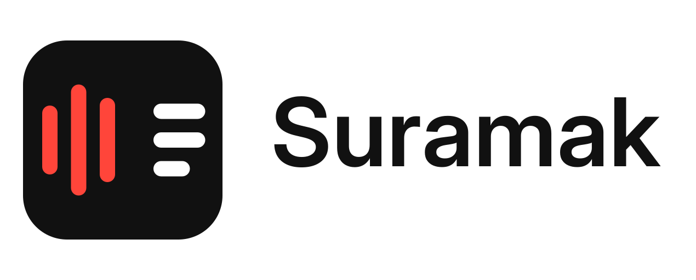

# Suramak



Local-first transcription app. Fully native, written in Rust. **macOS first; Windows and Linux ports to follow.**

- On-device transcription (whisper.cpp via whisper-rs) — English + Indonesian first.
- Fast path on Apple Silicon: the Whisper encoder runs on the Neural Engine via the official Core ML encoder package (`--engine coreml`; `auto` picks it when installed).
- Import files + microphone recording, timestamped segments, editable transcript.
- Export Markdown / TXT / JSON (+ SRT / VTT) — take it to any LLM you like.
- Optional in-app "polish" via your own OpenAI-compatible endpoint — review side-by-side, accept/undo/discard; the app works fully without it.
- No telemetry. Network only for model downloads and opt-in polish.
- Liquid Glass on macOS 26+ (fallback for older); DWM Mica/Acrylic backdrop on Windows (compile-checked; runtime unverified).

## Status

- ✅ `suramak-core` — types, storage (sqlite), export, model download w/ sha256, decode, resample, polish client — fully tested
- ✅ `suramak-asr` — whisper-rs pipeline + worker thread (record-then-transcribe), verified end-to-end
- ✅ `suramak-cli` — `models` / `transcribe` / `export` / `library` / `polish` / `doctor`
- ✅ engine tiers — CPU / Metal / Core ML-ANE (`--engine`, `doctor` reports the stack; M1.5)
- ✅ `suramak-ui` — the app: import/record → transcript → edit → export, model manager, settings, in-app polish (M4; polish round-trip + all Mac-only behavior are user-smoke items)
- ✅ `suramak-glass` — AppKit materials (macOS) + real DWM backdrop (Windows, compile-checked from Linux) + Linux no-op
- 📋 release handoff — `scripts/mac-smoke.sh` + `docs/USER_SMOKE.md` (run by the owner on the Mac)

## Layout

```
crates/suramak-core   portable domain logic (no UI, no whisper)
crates/suramak-asr    whisper-rs pipeline + worker (feature-gated mic capture)
crates/suramak-glass  AppKit glass integration (objc2) + DWM backdrop (Windows) + Linux no-op
crates/suramak-ui     the app window (winit + egui, no webview)
crates/suramak-cli    headless CLI (also powers CI end-to-end tests)
```

Technical plan: `docs/PLAN.md` · verified engineering notes: `docs/PLAN-NOTES.md` · milestones: `docs/WORKORDER-*.md` · reports: `docs/reports/`.

## Build (dev)

```bash
cargo build --release -p suramak-cli   # CLI
cargo build --release -p suramak-ui    # the app
./scripts/make-app.sh                  # macOS: dist/Suramak.app
bash scripts/mac-smoke.sh              # macOS: full release smoke → docs/USER_SMOKE.md
```

Models are downloaded on demand (`suramak-cli models download <id>`, sha256-pinned).

## License

GPL-3.0-or-later — see [LICENSE](LICENSE).
