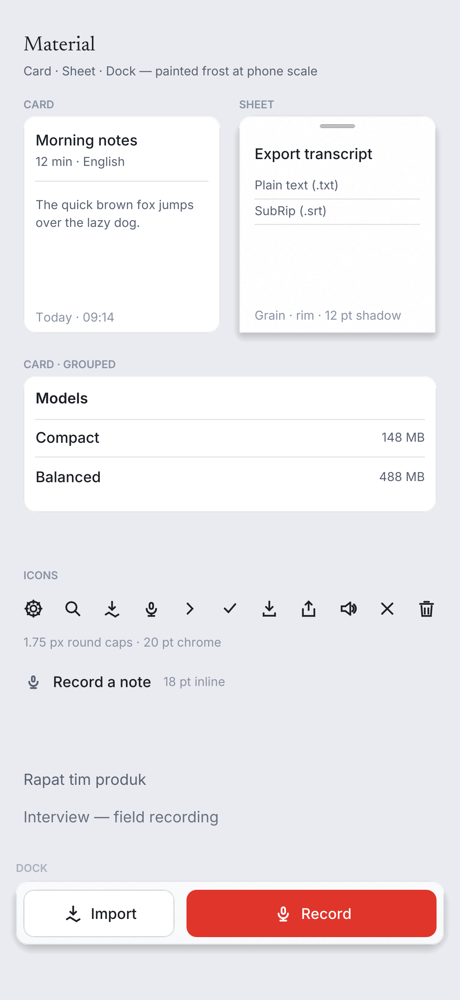
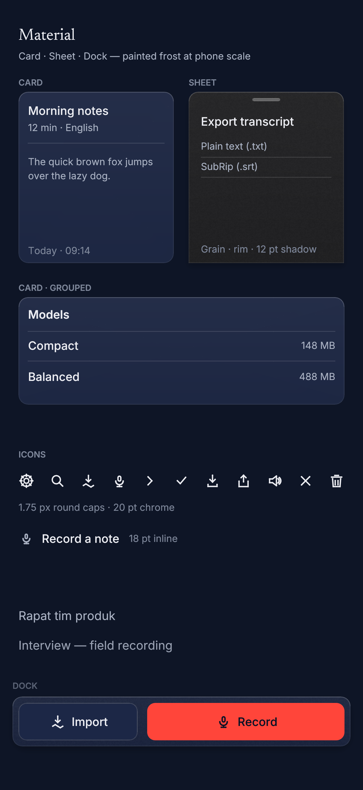

# M20B — frosted material + vector primitives

Executed per `docs/WORKORDER-M20B.md` (slice 2 of 5 of
`docs/reports/M20-ui-refresh-plan.md`). This slice adds the **material layer**
and the **painted icon kit**; it does not restyle a single screen. The compact
screens still call `compact::chrome::card` / `chrome::setting_row`; slices 3–5
adopt the primitives below.

**Run status.** `fmt --check`, `clippy --workspace --all-targets -D warnings`,
the full workspace suite (**1,215 passed / 0 failed**, baseline 1,202 + 13
new), and the Android cross-check (`cargo ndk -t arm64-v8a check` + `clippy` on
`suramak-android` and `suramak-android-spike`) are green. `suramak-glass` also
compiles for `aarch64-apple-darwin` with the new capability probe. The macOS
`suramak-ui` target could not be compiled on this Linux host — `ring`'s C build
needs a macOS `cc` — so the macOS UI branch is proved by inspection plus the
glass-crate cross-check, not by a macOS build. No emulator run (no KVM on this
host); the Android proof is the NDK compile/clippy gate.

---

## 1. The capability: `MaterialBackend`

`crates/suramak-ui/src/deck/material.rs`

```rust
pub enum MaterialBackend { SystemGlass, PaintedFrost }

impl MaterialBackend {
    pub fn detect() -> Self;                    // macOS probe, PaintedFrost elsewhere
    pub const fn from_system_glass(available: bool) -> Self;
    pub const fn paints_frost(self) -> bool;
    pub fn apply(self, tokens: &mut Tokens);    // zeroes the seven frost tokens
}
```

The probe is `suramak_glass::system_glass_available()` (new in
`crates/suramak-glass/src/lib.rs`, backed by `macos::system_glass_available()`).
macOS always has a real material path — `NSGlassEffectView` on macOS 26+,
`NSVisualEffectView` below it — so it answers `true`; Windows, Linux and
Android answer `false` without probing anything. The function reports the
**platform** capability, not a particular window's applied state; the latter
stays `GlassHandle::float_glass_available()`.

`theme::tokens(theme)` now resolves `tokens_for(theme, MaterialBackend::detect())`.
Under `SystemGlass` the seven M20B tokens are zeroed and `frosted_panel` paints
**only the base token fill** — no veil, no rim, no grain, no dock scrim. The
legacy ladder (`window`, `panel`, `card`, `sheet`, ink) is untouched, which is
the "no screen restyle" rule: the existing window is already transparent on
macOS, so AppKit's optical material shows through exactly as before. There is
no painted imitation of Liquid Glass in the frame.

## 2. The seven frost tokens

Authored in **both** ladders (`macos_ladder`, `desktop_ladder`) and both
appearances. Alpha is expressed as a percentage of 255 and rounded once in
`theme::percent`.

| token | dark | light |
|---|---|---|
| `frost_veil_top` | white 4.5 % (α 11) | white 62 % (α 158) |
| `frost_veil_bottom` | white 1.2 % (α 3) | white 38 % (α 97) |
| `rim_specular` | white 13 % (α 33) | white 75 % (α 191) |
| `rim_hairline` | white 6 % (α 15) | black 7 % (α 18) |
| `frost_grain_alpha` | 1.8 % (texture α 5/255) | 1.2 % (texture α 3/255) |
| `dock_scrim_top` | `TRANSPARENT` | `TRANSPARENT` |
| `dock_scrim_bottom` | window base @ 92 % (α 235) | window base @ 92 % (α 235) |

`dock_scrim_bottom` needs an **opaque** stand-in for "92 % window": the macOS
`window` token is `TRANSPARENT` by design, so the macOS ladder uses its material
base (`#f2f2f7` light / `#1c1c1e` dark) and the desktop ladder its own window
tone (`#e9ebf0` / `#0e1526`). Under `SystemGlass` the scrim is zeroed anyway.

### 2.1 Contrast on the veiled fills

New test `the_frost_tokens_exist_per_ladder_and_keep_ink_legible` composites
the veil at **both gradient stops** over the same worst-case backdrop the M9d
test uses (white light / black dark), then measures `ink` and `ink_soft`
against the result. AA floor is 4.5:1.

| ladder / appearance | ink on card top → bottom | ink_soft on card top → bottom | ink on sheet top → bottom | ink_soft on sheet top → bottom |
|---|---|---|---|---|
| macOS Light | 16.49 → 16.49 | 6.23 → 6.23 | 16.49 → 16.49 | 6.23 → 6.23 |
| macOS Dark | 12.28 → 13.44 | 6.67 → 7.30 | 12.92 → 14.07 | 7.02 → 7.64 |
| desktop Light | 16.49 → 16.49 | 6.23 → 6.23 | 16.49 → 16.49 | 6.23 → 6.23 |
| desktop Dark | 11.63 → 12.64 | 6.32 → 6.86 | 12.92 → 14.07 | 7.02 → 7.64 |

The test also pins the authored alphas per appearance, asserts the veil falls
top → bottom, and asserts `dock_scrim_top` is fully transparent. The report's
numbers are the `--nocapture` output.

## 3. The primitives

`crates/suramak-ui/src/deck/material.rs`

```rust
pub fn frosted_panel(ui: &Ui, tokens: &Tokens, rect: Rect,
                     radius: impl Into<CornerRadius>, plane: Plane);
pub fn scrim(ui: &Ui, rect: Rect, tokens: &Tokens);
pub fn dock_scrim(ui: &Ui, rect: Rect, tokens: &Tokens);
pub fn card(ui: &Ui, tokens: &Tokens, rect: Rect,
            divider_after: Option<f32>) -> Rect;      // the content rect
pub fn veil_mesh(rect: Rect, radius: CornerRadius,
                 top: Color32, bottom: Color32) -> Mesh;
pub fn grain_image(alpha: u8) -> ColorImage;           // 64 × 64, deterministic
pub fn grain_texture(ctx: &Context, alpha: u8) -> Option<TextureHandle>;
```

```rust
pub enum Plane { Card, Sheet, Dock }
impl Plane {
    pub const fn shadow(self) -> Shadow;      // Card: NONE; Sheet/Dock: 12 pt blur, +4 Y, 22 % black
    pub const fn takes_grain(self) -> bool;   // false for Card
    pub const fn base(self, tokens: &Tokens) -> Color32; // card / sheet / panel
}
pub const CARD_PADDING: f32 = 12.0;
pub const GRAIN_TILE: usize = 64;
```

**Draw order:** shadow (floating planes only) → base token fill → veil mesh →
grain (Sheet/Dock) → 1 px `rim_hairline` inside the radius → 1 px specular over
the straight top edge and the two upper corner tangents. Cards get no grain;
sheets and the dock do. `scrim` is the modal dim; `dock_scrim` is the
clear→92 % `window` fade behind the floating dock.

**The veil mesh.** A square panel is the plan's **four-vertex** vertical
gradient (two triangles, `WHITE_UV`, zero texture binds). A rounded panel
tessellates the same gradient around the corner arcs (a centre fan) because a
four-vertex quad paints past a 12 pt radius and squares off the silhouette —
very visible at the light ladder's 62 % top stop. The test
`a_rounded_veil_follows_the_arcs_instead_of_squaring_the_corners` pins the
behaviour, and `the_veil_is_a_four_vertex_gradient_on_a_square_panel` pins the
literal four-vertex case.

**A measured pitfall for slice 3.** `deck::motion::lerp_color` builds its result
with `Color32::from_rgba_unmultiplied`, which premultiplies a second time. That
is harmless for opaque colours, but it turns a 4.5 % white veil into an opaque
grey (measured: `#FF` card became `#9F`). The gradient uses its own
premultiplied channel mix; do not pass translucent tokens through
`lerp_color`.

**Grain.** 64 × 64 SplitMix-style integer hash, white *and* black texels at the
token alpha (a zero-mean sparkle that breaks banding in both directions),
`TextureWrapMode::Repeat`, linear magnification. Cached per alpha in `ctx.data`
so light and dark each upload once, and no texture exists under `SystemGlass`
(alpha 0 → `None`). Size: 64 × 64 × 4 B = **16 KB**, not the plan's "4 KB"
(64² RGBA cannot be 4 KB); still negligible. The host rasteriser gained UV
wrapping in `deck/snapshot.rs` so the `Repeat` tile renders in the goldens.

**Shadow budget.** `Card` = `Shadow::NONE`. `Sheet`/`Dock` share
`FLOAT_SHADOW` = `{ offset: [0, 4], blur: 12, spread: 0, black α 56 }` (22 %).
Exactly two floating planes, as the plan requires.

## 4. The icon kit

`crates/suramak-ui/src/deck/icons.rs`. 1.75 px strokes, round caps and joins
drawn explicitly (epaint's open paths are butt-capped: `TODO(emilk): add line
caps`), 18 pt inline / 20 pt chrome, 44 × 44 pt chrome hit box. Every icon's
interactive path is `a11y::touch` before a pixel is painted.

```rust
pub enum IconSize { Inline /* 18 */, Chrome /* 20 */ }
pub enum Icon { Gear, Search, ImportWave, Mic, Chevron, Check,
                Download, Share, Speaker, Close, Trash }
pub fn paint(painter: &Painter, rect: Rect, icon: Icon, size: f32, color: Color32);
pub fn button(ui: &mut Ui, tokens: &Tokens, rect: Rect, id: impl Hash,
              icon: Icon, label: &str, size: IconSize, enabled: bool) -> Response;
pub fn gear(ui, tokens, rect, id, size) -> Response;   // …and ten more wrappers
```

| icon | default spoken label | notes |
|---|---|---|
| `gear` | "Settings" | 8 teeth + hub; the app-bar trailing affordance |
| `search` | "Search transcripts" | lens + 45° handle; 16–18 pt in the field |
| `import_wave` | "Import audio" | down arrow over a wave; the dock's Import pill |
| `mic` | "Record" | capsule + cradle + stem; the dock's Record pill |
| `chevron` | "Back" | right chevron (the nav glyph) |
| `check` | "Installed" | model-list selected state |
| `download` | "Download" | arrow + tray; model download |
| `share` | "Share" | iOS-style box + up arrow |
| `speaker` | "Play" | cone + two arcs |
| `close` | "Close" | sheet dismiss |
| `trash` | "Delete" | lid + tapered body |

Tests: every icon's ink stays inside its hit box at both sizes
(`visual_bounding_rect` over the frame's shapes), every wrapper records a
`WidgetType::Button` with a non-empty label, and the stroke/size constants are
pinned.

## 5. Card anatomy

`card()` is the one helper slices 3–5 adopt: `frosted_panel(Plane::Card)` + the
standard 12 pt padding, returning the content rect; an optional 1 px
`hairline` divider at `divider_after` points below the card top. It does not
migrate anything: `compact::chrome::card` remains the screens' current
primitive until the slice that touches them.

## 6. Goldens

`tests/ui-compact/shots/material-kit-light.png` and `material-kit-dark.png`
(1216 × 2640, the phone viewport at 2.6×) are written by
`tests/ui_compact.rs::material_kit_goldens_show_card_sheet_and_dock_in_both_appearances`.
The scene draws, on the **PaintedFrost** backend regardless of host:

* Card and Sheet side by side (top-only radius on the sheet, grabber, 12 pt
  shadow) plus a full-width grouped card with a divider — the card anatomy;
* all eleven icons at 20 pt, plus one 18 pt inline sample;
* the floating dock over its scrim, Import (outlined secondary) and Record
  (red primary);
* two content rows behind the dock's fade.

The same test asserts, per appearance: the dark veil genuinely falls top →
bottom; the light card is the white token + white veil (see the boundary
below); the hairline rim reads against the fill; the sheet casts the float
shadow while the card does not; the dock is opaque and distinct from the
window; and the icon strip contains real ink.





## 7. The honest boundary

* **Screens adopt in slices 3–5.** No compact or desktop screen calls
  `frosted_panel`, `scrim`, `dock_scrim`, `card` or `icons` yet. This slice is
  the material and the kit, verified on their own goldens. When a screen does
  adopt `card()`, it must **replace** `chrome::card`'s fill, not draw the
  primitive over it — two base washes would double the card tint.
* **SystemGlass removes the painted frost, not the legacy ladder.** On macOS
  the zeroed tokens mean the primitives add nothing over AppKit's material; the
  existing `window` is transparent and `panel`/`card` keep their M9a
  translucent washes. The sheet token stays opaque by the earlier M14e
  decision (a modal must stay readable); M20B does not turn modals into glass.
* **Light mode's veil is a no-op on the opaque ladder's white card/sheet.**
  White at 62 % over `#ffffff` is `#ffffff`. That is arithmetic, not a missing
  paint: on the light desktop ladder the frost reads through the black-7 %
  hairline, the float shadow and the grain (sheet/dock). The 62 % top stop is
  meaningful over the macOS translucent card or any tinted base; the Android
  light card is already white. Slice 3 can decide whether the phone's light
  card token should carry a tint — that is a screen decision and was out of
  scope here.
* **macOS runtime is not exercised on this host.** The capability probe
  compiles for `aarch64-apple-darwin` in `suramak-glass`; `suramak-ui`'s macOS
  target is blocked by `ring`'s C toolchain, not by this slice. The guard
  behaviour itself is unit-tested on every host via
  `MaterialBackend::SystemGlass` (all seven alphas zero, base colours
  unchanged).
* **The plan's "4 KB VRAM" is 16 KB** for a 64 × 64 RGBA tile. Corrected here;
  the budget claim is otherwise satisfied (one tile per alpha, cached).
* **`frosted_panel` has no blur** — by design. Android has no single-surface
  backdrop blur, and egui 0.33 has no shader pass for one; the veil/rim/grain
  stack is the honest ceiling. No new crate and no engine change.
* **The icon row is a specimen**, not a toolbar: 11 icons at 20 pt across a
  467 pt phone would not all be touch targets. Real screens place 1–3 chrome
  icons inside 44 × 44 pt hit boxes.

## 8. Tests added

| test | what it pins |
|---|---|
| `theme::the_frost_tokens_exist_per_ladder_and_keep_ink_legible` | both ladders author all seven tokens; contrast on veiled card/sheet at both stops |
| `material::system_glass_zeroes_every_frost_alpha` | SystemGlass zeroes exactly the seven frost tokens, leaves the ladder alone |
| `material::the_backend_rule_is_the_probe` | pure rule + live `detect()` per platform |
| `material::the_shadow_budget_is_cards_zero_and_float_planes_one` | card `NONE`; sheet/dock 12 pt / +4 Y / 22 % |
| `material::the_veil_is_a_four_vertex_gradient_on_a_square_panel` | 4 vertices, 6 indices, UV `WHITE_UV`, alphas |
| `material::a_rounded_veil_follows_the_arcs_instead_of_squaring_the_corners` | rounded silhouette, no square-corner vertex |
| `material::the_grain_is_deterministic_and_alpha_scaled` | same bytes on two calls; pinned FNV-1a digest `0x85105b9862ee29e9`; both tones; alpha ceiling |
| `material::card_padding_is_the_standard_twelve_points` | 12 pt content inset + divider placement |
| `icons::every_icon_fits_its_hit_box_at_both_sizes` | 11 icons × 18/20 pt ink inside 44 pt |
| `icons::every_icon_is_a_labelled_button` | 11 Button semantics with the spoken labels |
| `icons::the_stroke_is_one_weight` | 1.75 px, 18/20, 44 pt constants |
| `glass::system_glass_is_a_macos_capability` | the probe is macOS-only |
| `ui_compact::material_kit_goldens_show_card_sheet_and_dock_in_both_appearances` | the two goldens + pixel-level material assertions |

## 9. Verification commands

```sh
cargo fmt --all -- --check
cargo clippy --workspace --all-targets -- -D warnings
cargo test --workspace

cargo ndk -t arm64-v8a --platform 29 check  -p suramak-android -p suramak-android-spike
cargo ndk -t arm64-v8a --platform 29 clippy -p suramak-android -p suramak-android-spike -- -D warnings
cargo check -p suramak-glass --target aarch64-apple-darwin
```

`cargo check -p suramak-ui --lib --target aarch64-apple-darwin` fails in
`ring`'s build script (`cc` is the Linux compiler); the failure is upstream of
this slice. The NDK checks are the gate that host tests cannot provide for
`cfg(target_os = "android")`.
