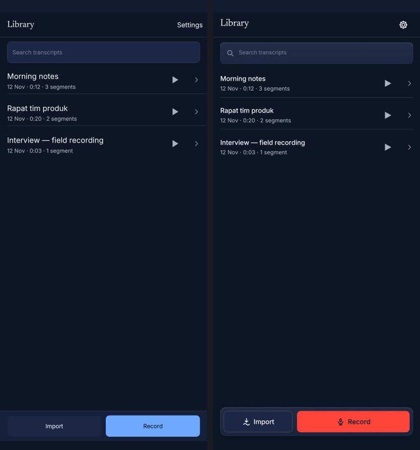
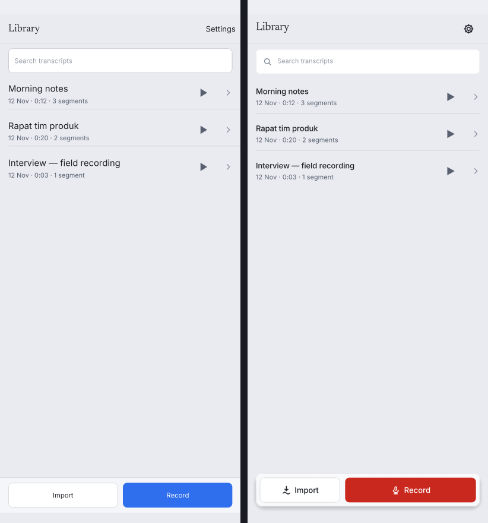
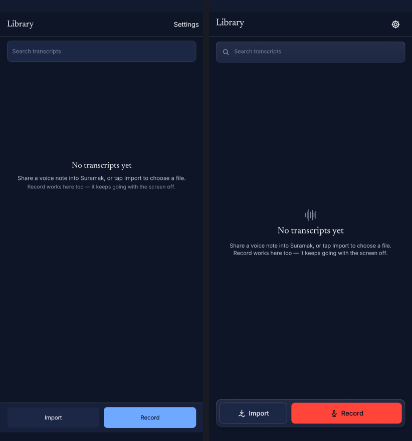
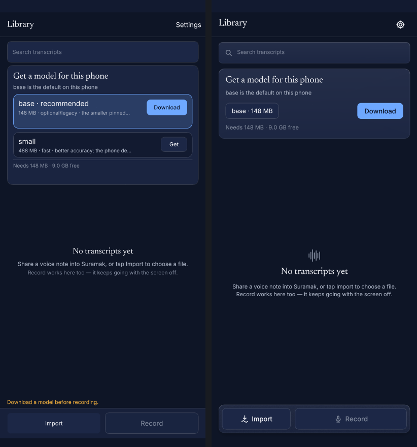
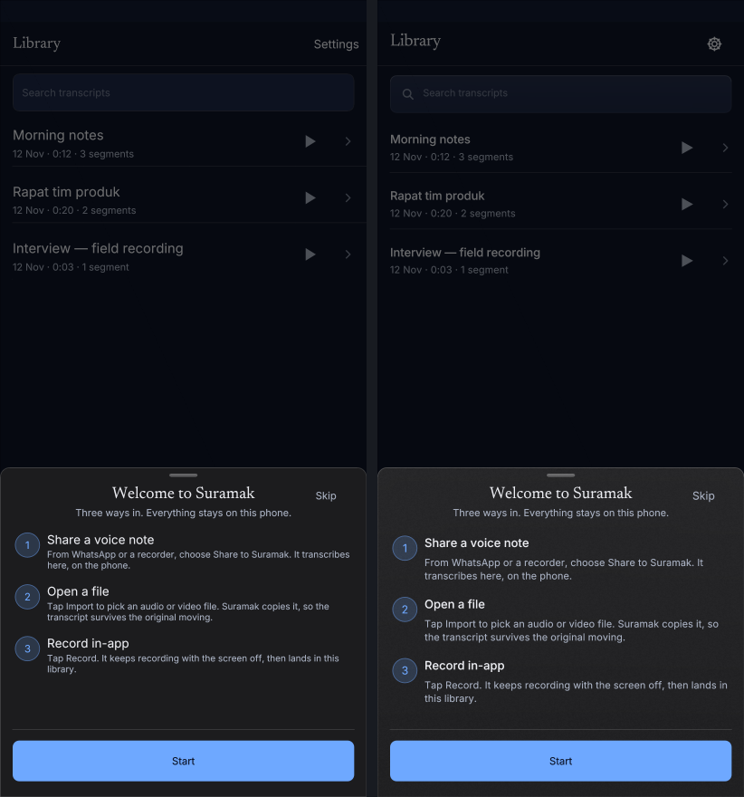
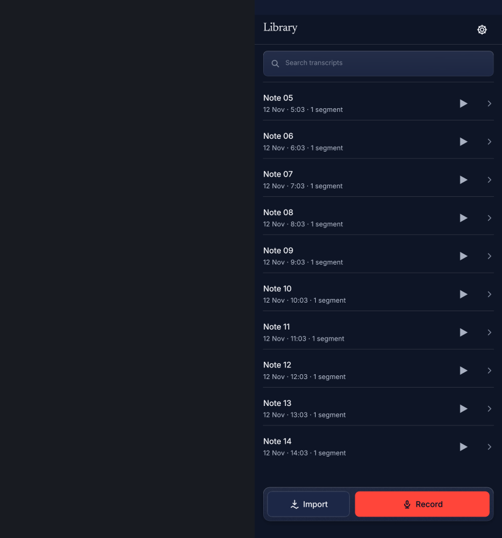
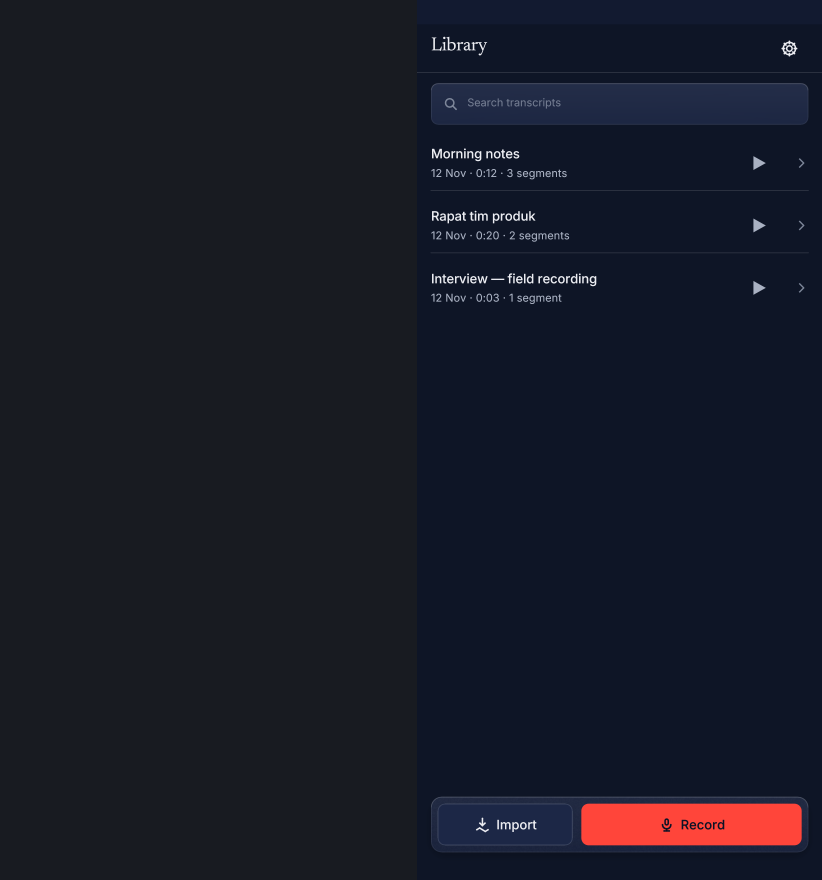
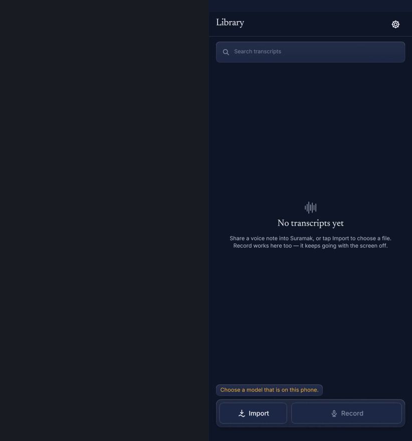

# M20C — the Library, redrawn

Slice 3 of the M20 UI refresh (`docs/WORKORDER-M20C.md`, plan §D). Phone only:
the desktop keeps its layout, and Settings/editor internals are untouched
(slices 4–5).

Base: `f0ffc34` (main, 1215 tests). The material kit (M20A type scale, M20B
frost/icon primitives) is consumed here, not reworked.

---

## What changed

### 1 · App bar — serif title at the title token, gear for Settings
`chrome::title_token()` is the type scale's **title** role (22 pt / −0.4 / 28 pt
line height) with the house serif face kept — the only per-screen override left
is the family, and it is named in one place. The trailing text action became a
20 pt gear in a 44 × 44 pt hit box, announced as **"Settings"**
(`icons::Icon::Gear.label()`), with hover/press ink from the token ladder. Text
trailing actions still exist for the editor/Settings/Diagnostics app bars (the
`Trailing` enum keeps both). A long transcript title is now laid out through a
clip and elided with `…` instead of running under the trailing control.

### 2 · Search — magnifier, caption placeholder, frosted Card plane
`chrome::search_field` paints `material::frosted_panel(.., Plane::Card)` (veil +
1 px rim, **no shadow** — it is in the scroll plane), the 18 pt magnifier inline
at the leading edge, the caption token's placeholder, and body-token entered
text. The caret is the accent stroke and the selection is the ladder's
`selection_bg` (already themed by `deck::theme::visuals`).

### 3 · Model banner — one shrink-wrapped frosted banner
`compact/first_run.rs` is rebuilt around one measured `BannerLayout`:

```
headline (Newsreader 21)            27
reason   (caption, ink_soft)         17
[language note (caption, warn, ≤ 2 lines, only when Indonesian)]
pill "base · 148 MB" + Download      36   ← one row, one primary
footer  "Needs 148 MB · 9.0 GB free" 17
```

* Height: **159 pt** (+38 Indonesian note, +32 running download, +22 failure
  message) versus the old 272–356 pt card whose `height()` was then stretched by
  `.min(available.max(220))`. `height()` and `card()` now share one layout
  function, so the reserved space cannot drift from the drawing
  (`debug_assert` pins it).
* No nested card: the pill is a 36 pt capsule, not an inner card; the old
  alternative-model rows ("small · Get") are gone — the banner is a
  recommendation, and the manifest stays in Settings (slice 4).
* The banner is **absent** when `model_card_needed()` is false (a verified,
  offered model on disk); the list starts directly under the search field.
* The old loose amber line above the action bar ("Download a model before
  recording.") is gone: the banner is the visible reason on a model-less phone,
  and the disabled Record still *speaks* its reason ("Record from the microphone
  — Download a model before recording."). When a verified model exists but the
  configured one does not, the banner is absent and the reason returns as a
  small chip above the dock.
* The download's job percent, progress and resume/failure state remain (Pause
  owns the button while running), laid out in the banner's footer.
* Copy is unchanged (`Get a model for this phone`); Indonesian's `tiny` warning
  is still shown — now as the banner's second line rather than a loose card.

### 4 · Rows — type scale, inset hairline, press motion
`chrome::row` now paints:

* title in **row title** (15 / −0.1 / 20), meta in **caption** (12.5 / +0.1 / 17),
  both one line with `…` so the 64 pt grid holds for any title;
* a 1 px hairline inset 16 pt on **both** sides (the old rule ran to the screen
  edge), and no divider after the last row (`divider` flag) — the old shot
  erased it by over-painting the window;
* the M20A press: `PressMotion` — `FAST` (120 ms) down to 0.97 with the
  `surface_active` wash, `SPRING_DURATION` (240 ms) back out. The scale is
  applied to the painted body (text and trailing affordances map with it); the
  hit rect never scales, and Reduce Motion keeps the wash and drops the scale
  (both proven in `chrome::tests`).

### 5 · Empty state — waveform, Newsreader, two lines
Centred between the banner (or the search field) and the dock: a 28 pt
seven-bar waveform glyph in `ink_faint`, **Newsreader 21 pt** "No transcripts
yet" (editorial-display token), then the owner-approved copy as two centred
`ink_soft` caption lines. Copy is verbatim; the old two-tone split
(`ink_soft`/`ink_faint`) is now one prompt voice.

### 6 · Floating dock — the record red, over the list
`chrome::dock_rect`: 16 pt side inset, **64 pt** tall, 12 pt above the gesture
inset; `material::dock_scrim` fades the list above it; `frosted_panel(Plane::Dock)`
supplies the veil, grain, rim and the one float shadow. Inside, a 38 / 62 split:

* **Import** — secondary pill, `control_fill` + hairline, import-wave icon.
* **Record** — primary pill, `record_fill()` = the record red (`#FF453A` dark),
  deepened to the text-safe `record_red_text` **only** on the light ladder,
  where white on `#E0352B` is 4.46:1 (the text-safe red is 5.56:1). Mic icon and
  label ride `on_accent`. A unit test asserts ≥ 4.5:1 on both ladders.
  Disabled (no runnable model) = `control_fill` + `ink_faint`, still 48 pt,
  still announced with its reason.

The list's bottom padding is `list_bottom_padding()` = gap + dock + gesture
inset + 16 (24 when the disabled-Record reason chip is up). On the 467.7 pt-wide
golden viewport (bottom inset 20) that is **112 pt**; the test walks insets
0 / 20 / 54 and asserts `padding ≥ dock height + inset` for each. The dock is
painted after the list, so it is above it in paint and hit-test order.

One edge state gained a home: a phone with a **verified model that is not the
configured one** has no banner but cannot record. The reason
("Choose a model that is on this phone.") now sits in a small frosted chip just
above the dock; when the banner is present the banner already carries the
reason, so the chip is suppressed (no duplicate message).

### 7 · Sheets — Sheet plane + full slide
`chrome::sheet` paints `material::scrim` + the `Plane::Sheet` material (opaque
sheet fill, veil, grain, rim, the one float shadow) and takes the present
progress: the body now travels its **full height** (`translateY(100% → 0)`)
instead of the old 14 pt rise. Reduce Motion passes 1.0 (no travel; the fade
remains). The onboarding sheet adopts the type scale (Newsreader display hero,
row-title steps, caption bodies, two-line clamp) and drops its hand-drawn
rect_stroke — the material rim does that job. Copy is unchanged.

### Supporting fix — the offscreen rasteriser's texture residency
The new scrolled golden is shot from the interactive harness, whose earlier
frames upload the material grain. `deck::snapshot` previously built an empty
texture table per call, so a texture uploaded in an earlier frame fell back to
white and painted a white dock. `snapshot::note_textures` + a `Context`-held
texture table make the seam behave like a real renderer; `render_at` lets a
harness shot carry the harness's own input time instead of replaying at 0.
Both are test-seam changes, no shipping renderer touched.

---

## Before / after

Left = before at `f0ffc34`; right = after in this working tree. Full-size raw
goldens are under `tests/ui-compact/shots/`; the "before" bytes are recoverable
with `git show f0ffc34:tests/ui-compact/shots/<name>.png > /tmp/<name>.png`.

| Screen | Before / after |
|---|---|
| Library |  |
| Library — light |  |
| Library — empty |  |
| Launch (model verified) |  |
| First run / download banner |  |
| Onboarding sheet |  |

New goldens (no "before" — the states did not have a shot):

| Screen | Shot |
|---|---|
| Scrolled to the bottom (dock clearance) |  |
| Model verified → banner absent |  |
| Verified-but-not-configured model → reason chip |  |

Concrete deltas in the shots:

* header: text "Settings" → 44 pt gear; title 20 pt → 22 pt serif with tracking;
* search: flat rect + no icon → frosted plane + 18 pt magnifier + caption hint;
* first run: 356 pt card with a nested blue-bordered row and ~80 pt hole →
  159 pt banner with a pill/button row and the storage caption;
* rows: 17 pt titles, full-width rules → 15 pt titles, caption meta, inset
  hairlines, no dangling last rule;
* empty: 19 pt serif + two colours of hint → 28 pt waveform + 21 pt Newsreader +
  one 2-line prompt;
* bottom: full-width bar rule + blue Record → floating frosted dock, secondary
  Import, record-red Record with mic, list scrolling underneath.

The Settings / editor / diagnostics / export-sheet goldens were also re-blessed:
they share `chrome::app_bar`, so their titles moved to the 22 pt serif token and
now elide instead of overflowing. No layout or content change on those screens.
The desktop crates and `tests/ui-desktop/shots/` are untouched by this slice
(the desktop golden test rewrites its own shots on every workspace run; its
pixels drift by ~0.01 % between runs, and those bytes were restored).

---

## Verification

| Gate | Command | Result |
|---|---|---|
| Phone suite | `cargo test -p suramak-ui --test ui_compact` | **27 passed**, 0 failed (goldens re-blessed) |
| Press motion (unit) | `cargo test -p suramak-ui --lib deck::compact::chrome` | 2 passed: FAST-in/spring-out, Reduce-Motion drops the scale |
| Dock clearance / Record contrast (unit) | `cargo test -p suramak-ui --lib deck::compact::library` | 3 passed |
| Formatting | `cargo fmt --all -- --check` | clean |
| Lints (host) | `cargo clippy --workspace --all-targets -- -D warnings` | exit 0 |
| NDK check | `cargo ndk -t arm64-v8a --platform 29 check -p suramak-android -p suramak-android-spike` | exit 0 |
| NDK lints | `cargo ndk -t arm64-v8a --platform 29 clippy -p suramak-android -p suramak-android-spike --all-targets -- -D warnings` | exit 0 |
| Workspace suite | `cargo test --workspace` | **1224 passed, 0 failed, 10 ignored** (36 binaries; 1215 → 1224, +9 tests) |
| Android screencap gate | `python3 tests/android-smoke/inspect_screencap.py --self-test --reference-dir tests/ui-compact/shots` | positives pass (3 band tones, bottom band 0.26 contrast share), blanks fail |

Tests added:

* `the_library_wears_the_type_scale_and_the_gear_is_settings` — title token
  equality (size/tracking/line height + serif), caption placeholder, row tokens,
  gear 44 × 44 in the app bar with the "Settings" label.
* `the_list_clears_the_dock_and_the_gesture_inset` — padding ≥ dock + inset for
  insets 0/20/54; dock sits 12 pt above the gesture area.
* `the_dock_pills_are_touch_targets` — 48 pt, no overlap, 38/62 split.
* `the_record_fill_is_legible_on_both_ladders` — `on_accent` ≥ 4.5:1 on the fill.
* `the_press_is_fast_in_and_springs_out` / `reduce_motion_drops_the_press_scale`.
* `the_banner_is_absent_when_a_verified_model_is_in_use` — no banner label and
  the list starts at the search field.
* `the_scrolled_library_clears_the_floating_dock` — 14 rows, two swipes, the
  last row ends ≥ 8 pt above the dock and within 120 pt of it (it really is at
  the padding), plus the `library-bottom` golden.
* `a_model_chosen_elsewhere_explains_the_disabled_record` — the chip, the spoken
  reason, and the extra list clearance.
* The existing a11y floor (`every_compact_control_carries_a_label_and_a_role`)
  still records every control, now including the gear and both dock pills.

Honest note on the full runs: the first `cargo test --workspace` hit one
**pre-existing, unrelated** flake in `suramak-android`'s host mic test
(`a_capture_that_dies_is_settled_as_a_stream_error`, `!status.recording`); it
passes in isolation and passed in both full runs afterwards. The final full run
is green (1224/0/10).

Not run here: the emulator smoke (no `adb`/emulator on this VPS). Its Library
screencap gate was validated against the re-blessed references by the
`--self-test` above; the `SURAMAK-LAYOUT` clearance assertion is Settings-only
and untouched.

---

## The honest remainder (what still looks dated until slices 4–5)

**Settings (slice 4)** — content is untouched, so it still shows:

* raw model slugs (`tiny`, `base`, `small`) and their `CI + tests` /
  `optional/legacy` role strings (from `suramak-core::models`); four separate,
  individually outlined model cards instead of one grouped card with hairlines;
  the model table's blue outline treatment is the old control language;
* the `Quit Suramak` row on Android (not cfg-gated); no human tier names, no
  "Recommended" badge treatment;
* section labels and notes are still 11.5 pt ad-hoc; Settings' rows still use
  16 / 12.5 pt numbers rather than the type scale;
* its app bar is now the 22 pt serif title, which makes the rest of the screen
  read one step more dated than before.
* Diagnostics (reached from Settings) is still the old counter card: fixed
  11–12 pt read-outs, no type scale, no mono/diagnostic grouping. The raw engine
  and asset strings are already confined there, so slice 4's de-jargoning is
  mostly copy plus the grouped-model card, not relocation.

**Editor (slice 5)** — untouched:

* segment rows still use the pre-scale sizes (17 pt titles in the list body,
  12 pt meta), the transport/export buttons still use the old `controls::Tier`
  language, and the export/quit sheets keep their own inner layout (they now sit
  on the Sheet plane and slide, but their contents are not redrawn);
* no `tnum` timecodes (the numeral-cell helper is landed but unused), no
  recording pulse, no success badge, no editor list insert/remove motion;
* the editor's "Find" field inherits the new frosted/magnifier search chrome
  (same helper), but the editor's results strip is still the old layout;
* the onboarded sheet's body is redrawn, but the numbered step badges are still
  accent-tinted circles rather than part of a shared step component.

**Library leftovers (deliberately out of this slice):**

* the job strip is a plain frosted card with the old 14/3 pt progress bar and no
  cancel affordance; it is not the redesigned banner's state machine;
* rows still carry **two** trailing affordances (play triangle + chevron) inside
  separate 48 pt targets; they are reachable but visually close — a slice-4/5
  decision is whether both survive;
* the dock's Record shows a static mic when idle and keeps the mic when
  recording (`Stop` label) — the M20A RMS halo/pulse is not wired yet;
* scroll edge rubber-band (`motion::RubberBand`) is landed but not applied to
  the Library list;
* the banner's Download is accent blue while the dock's Record is red. They are
  never enabled at the same time (the banner only exists with no verified model,
  which disables Record), so the "one accent per viewport" rule holds in every
  state — but it is a state-machine guarantee, not a visual one.
