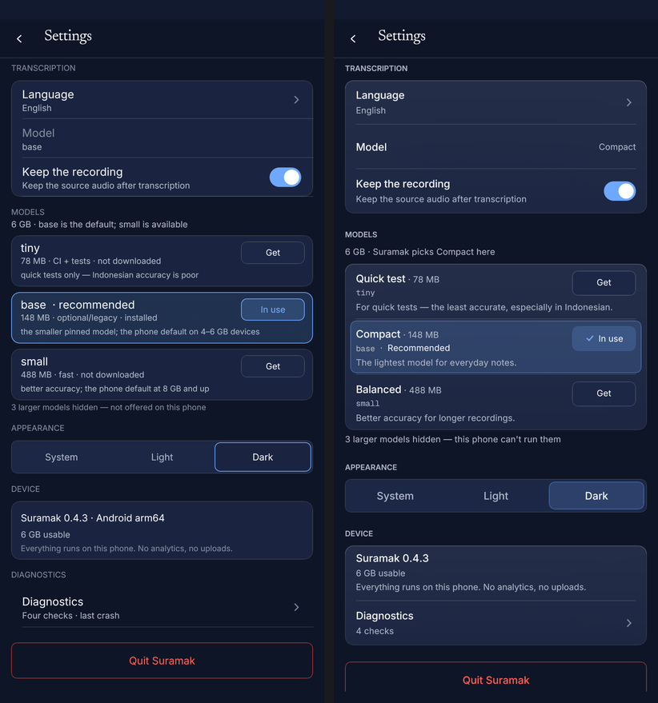
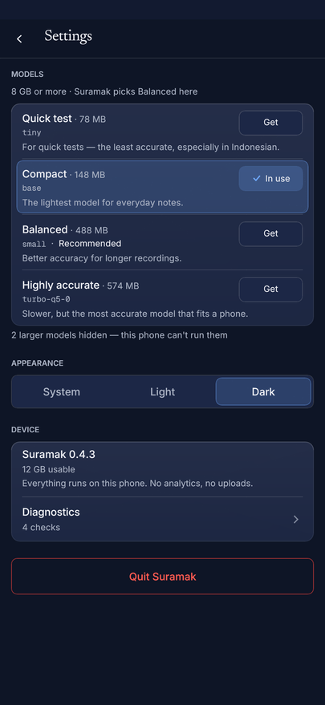
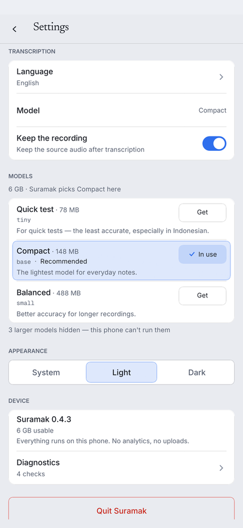
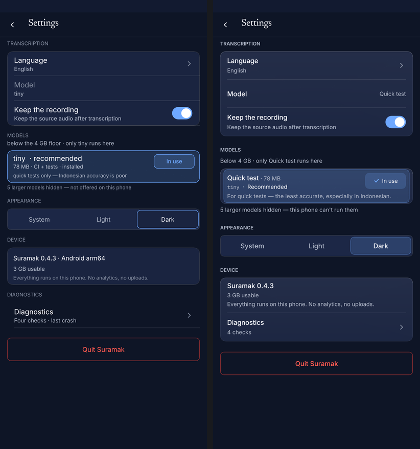
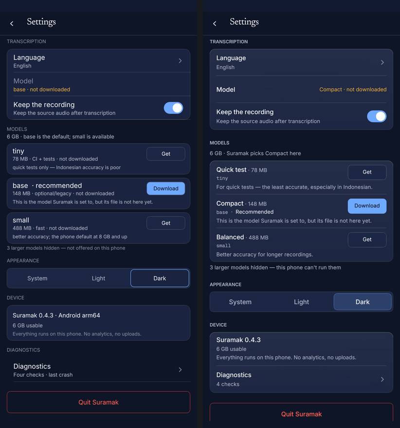
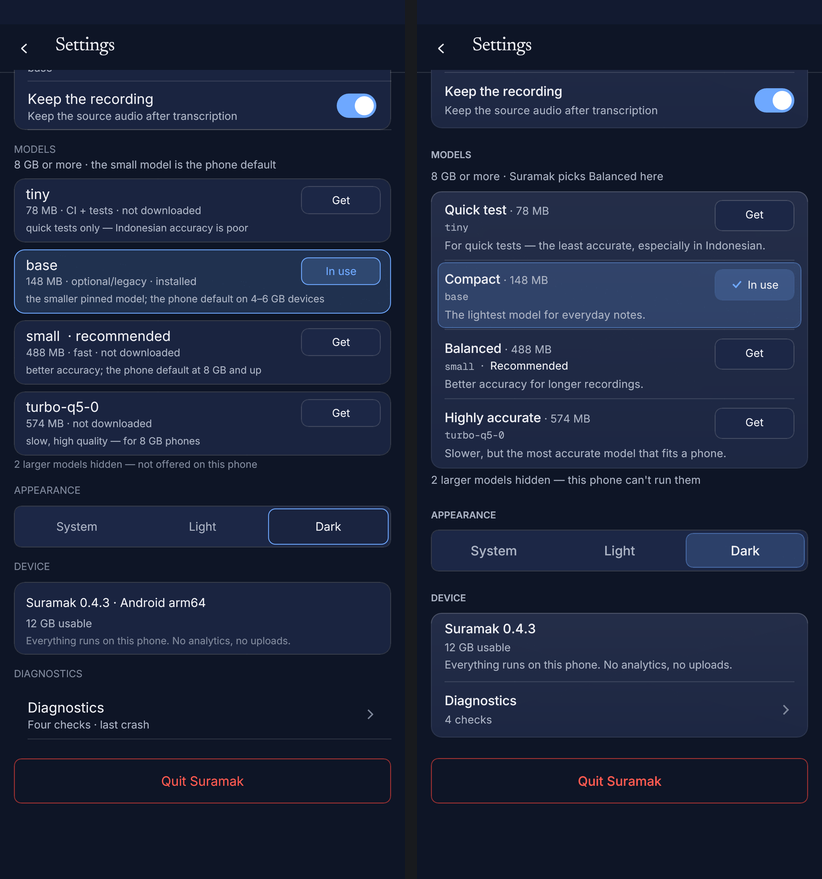
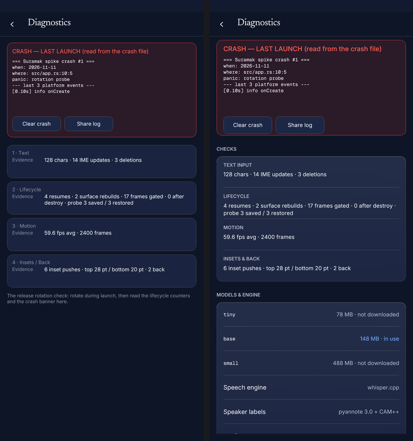

# M20D — Settings, de-jargoned and grouped

Slice 4 of the M20 UI refresh (`docs/WORKORDER-M20D.md`, plan §D). Phone only:
the Library and the editor are untouched, and no model-state logic changed —
this is display, hierarchy and copy.

Base: `20d3670` (main, 1224 tests). The M20A/B/C foundations (type scale, frost
material, icon kit, motion, the redrawn Library) are consumed, not reworked.

---

## What changed

### 1 · One grouped model card, human tiers first

The four per-model cards are **one** frosted card (`material::frosted_panel(..,
Plane::Card)`: veil + 1 px rim, **no shadow** — it scrolls) with hairline
dividers inset 16 pt on both sides and no divider after the last row.

Each row is 80 pt, on the 8 pt grid, and reads top to bottom:

```
Balanced · 488 MB                         ← tier name (row title) + size (caption)
small · Recommended                       ← manifest id in Geist Mono; the tag follows the id
Better accuracy for longer recordings.    ← one truthful, human sentence
                                                    [ Get / Use / Download / ✓ In use ]
```

* **Tier names** (`ModelRow::tier_name`): Quick test (78 MB), Compact (148 MB),
  Balanced (488 MB · Recommended), Highly accurate (574 MB). The manifest ids
  (`tiny`, `base`, `small`, `turbo-q5-0`) stay on the **mono second line** and
  in Diagnostics, so support can still name the file exactly; they are never
  the first thing a person reads.
* **Recommended** is attached to the row's id line, not floating beside the
  action. It is set from the same `row.recommended` flag M13D already used.
* The third line is the honest one: a live job's `Downloading · 42% · 5 MB of
  148 MB`, the stale-file sentence, the configured-but-missing sentence, or
  the tier's purpose (`ModelRow::phone_note`, new display copy — the manifest
  note's RAM-band vocabulary is not shown).
* The action is a 36 pt painted pill inside a **48 pt hit area**, placed on the
  name/id lines so the full-width sentence underneath can never run under it.
  `In use` is painted as a **status** (tint fill, no outline, check icon), not
  a button. The five-state machine and every action word are M19B's, unchanged:
  `Get`, `Resume`, `Cancel`, `Re-download`, `Use`, `In use`.
* An empty offered set says `No model fits this phone.` instead of an empty
  card; the hidden-models sentence is unchanged in meaning (`N larger models
  hidden — this phone can't run them`).

The TRANSCRIPTION → Model row is now a **read-out**, not a fake control: one
line, value right-aligned, no chevron (the picker is the model card below). Its
value is the human tier (`Compact · not downloaded`) and keeps the M19B warning
ink when the file is missing.

### 2 · The rhythm and the label scale

| Where | Value |
|---|---|
| Screen margins | 16 pt (`GUTTER`, unchanged) |
| Section label → card | 8 pt |
| Card → next section label | 24 pt |
| Card padding / divider inset | 16 pt |
| Setting row | 64 pt; model row 80 pt; device facts 80 pt |

Section labels are now the type scale's **section label** role — Inter SemiBold
11 / +0.8 / 16, set in CAPS via `chrome::section_label`, which takes a top-left
point so the rhythm is arithmetic rather than re-derived at four call sites.

Cards use the **Card plane** (`material::frosted_panel`), not the legacy
`chrome::card` fill: veil gradient, 1 px `rim_hairline`, top specular, zero
shadow. `chrome::card` is untouched (the editor still uses it; no editor
changes this slice).

One deliberate deviation from the type-scale doc: section labels are painted in
`ink_soft`, not `ink_faint`. At 11 pt the light ladder's faint (`#8a92a2` on
`#e9ebf0`) is **2.6:1** — under the 4.5:1 small-text floor. `ink_soft` is 5.2:1
on the light window and 8:1 on the dark one. Hierarchy comes from size, weight
and caps, not from a failing alpha. The same correction applies to the mono id
line, the device note and the two status words on a tinted row (`Recommended`,
`In use` are ink; the accent lives in the tint, the stroke and the check).

### 3 · The primary surface, de-jargoned

| Before (phone Settings) | After |
|---|---|
| `6 GB · base is the default; small is available` | `6 GB · Suramak picks Compact here` |
| `tiny`, `base`, `small`, `turbo-q5-0` as titles | `Quick test`, `Compact`, `Balanced`, `Highly accurate`; ids on the mono line |
| `78 MB · CI + tests · not downloaded` | `Quick test · 78 MB` + `tiny` + a human sentence |
| `148 MB · optional/legacy · installed` | `Compact · 148 MB` + `base · Recommended` |
| `488 MB · fast · not downloaded` | `Balanced · 488 MB` + `small` |
| `the smaller pinned model; the phone default on 4–6 GB devices` | `The lightest model for everyday notes.` |
| `quick tests only — Indonesian accuracy is poor` | `For quick tests — the least accurate, especially in Indonesian.` |
| `Suramak 0.4.3 · Android arm64` | `Suramak 0.4.3` (platform moved to Diagnostics) |
| `Four checks · last crash` | `4 checks` / `4 checks · last crash` |
| `Quit Suramak` on Android | **hidden** (`#[cfg(not(target_os = "android"))]`) |

Where each word went:

* `CI + tests` / `optional/legacy` — **deleted**: the manifest role is no longer
  painted, and `size_role()` stopped appending it (it was the Library banner's
  TalkBack string too).
* `default (macOS)` — already filtered out of the phone rows by M19B
  (`desktop default` → empty role); with roles gone from the surface it cannot
  return.
* `pyannote-segmentation-3.0 + CAM++` — **Diagnostics**, as `Speaker labels ·
  pyannote 3.0 + CAM++`.
* `CPL` — was never on the compact surface (it is an editor/desktop metric);
  the plan's `Line length` rename belongs to slice 5.
* `SURAMAK_…` env names — were never on the phone surface (the API-key env path
  is desktop-only; the one `SURAMAK_` flag is a debug input log, not a setting).

A mechanical test now keeps all of them off the screen, including rows a
screenshot cannot reach.

`ModelRow::size_role()` no longer appends the manifest role: the Library
banner's TalkBack name was the last place a core `role` string (`CI + tests`,
`optional/legacy`) could reach the phone. It is the size now.

### 4 · Appearance — the accent-tint rule

System / Light / Dark stay a 48 pt segmented track (`control_fill` + hairline).
The selected segment is exactly the plan's rule: **`accent_tint` fill + a 1 px
`accent` stroke at 45 %**, never the old bright outline; the tint and the label
ink crossfade on the `FAST` token (120 ms), so a change reads as a state swap.

### 5 · Diagnostics — a chevron row, and the vocabulary it now owns

The Device card holds the facts (version, memory, the disk-truth note) and, under
a hairline, the **Diagnostics** row with a chevron and the live count:
`4 checks`, plus `· last crash` in the warning ink when a crash file exists.
`4` is `diagnostics::CHECK_COUNT`: the Diagnostics screen's row array is typed
`[(&str, &str); CHECK_COUNT]`, so the count cannot drift from what it draws.

Diagnostics itself is restyled on the same system: one grouped **Checks** card
(Text input, Lifecycle, Motion, Insets & back — the four M13b groups with their
evidence, labels at the 11 pt CAPS token), and a **Models & engine** card that
now owns the raw ids (`tiny`, `base`, `small` · size · state, in mono), the
speech engine, the speaker models (`pyannote 3.0 + CAM++`) and the platform
triple. The crash banner keeps its alarm treatment (red-tinted surface, mono
body, `Clear crash` / `Share log` with 48 pt hit areas).

The Quit confirm sheet needed no code here: the dispatcher already draws every
sheet through `chrome::sheet`, which is the **Sheet plane** (opaque sheet fill,
veil, grain, one float shadow) with the `translateY` slide; Reduce Motion keeps
the fade and drops the travel.

### 6 · Motion

Setting and model rows press with the M20A grammar — `FAST` (120 ms) down to
0.97 with the `surface_active` wash, `SPRING_DURATION` (240 ms) spring back —
via the same `chrome::press_frame` the Library uses. Reduce Motion keeps the wash
and drops the scale. The scroll/cancel behaviour from M19A is untouched.

---

## Machine contracts

### `SURAMAK-MODEL` (M19B) — unchanged

`crates/suramak-android/src/shell.rs` is untouched. The shell still logs, one
line per state change:

```
SURAMAK-MODEL header="base · not downloaded" model_id=base missing=1 can_record=0
SURAMAK-MODEL row=tiny state=not_downloaded in_use=0
```

* Row lines still carry the **raw manifest id** (`row.id`) and the same five
  slugs: `not_downloaded`, `downloading`, `stale_corrupt`, `installed`,
  `in_use`. `in_use` still requires a **verified** file (`ModelState::state`).
* The header is still `CompactApp::model_label()` — raw id plus the
  `· not downloaded` qualifier, so the smoke's `"not downloaded" in header`
  check and the Android host snapshot tests (`compact_host.rs`) are unchanged.
  Only the *painted* Settings copy uses the human tier.
* No model-state logic was edited: `ModelState`, `ModelRow::state`, the action
  match and the download actions are the M19B code with a new paint around it.

### `SURAMAK-LAYOUT` — same keys, the last control is now dynamic

Every key is byte-identical: `ts`, `settled`, `route`, `quit_top`,
`quit_bottom`, `device_top`, `device_bottom`, `clearance`, `viewport_bottom`,
`content_bottom`, `screen_bottom`, `inset_bottom`, `inset_top`.

What changed is *which* control the `quit_*` fields measure: the list's **real
last control**. That is the Quit row on desktop and the **Diagnostics row on
Android**, where Quit no longer exists. `LayoutProbe::from_controls` takes the
lower of the two labelled controls, so it works in both builds and in a golden
that draws both. A unit test pins the fallback:

```
the_probe_measures_the_lowest_of_quit_and_diagnostics   ← desktop: Quit;
                                                          android: Diagnostics
```

The Android clearance flow is unchanged: at full scroll the last control ends
above the viewport (which already excludes the gesture inset), with
`bottom_clearance = max(inset, 24 dp) + 16` of content padding (plus the
30 pt tail the clearance tests pin) under it.

---

## Verification

| Gate | Command | Result |
|---|---|---|
| Formatting | `cargo fmt --all -- --check` | clean |
| Lints (host) | `cargo clippy -p suramak-ui --all-targets -- -D warnings` | exit 0 |
| Lints (workspace) | `cargo clippy --workspace --all-targets -- -D warnings` | exit 0 |
| NDK check | `cargo ndk -t arm64-v8a --platform 29 check -p suramak-android -p suramak-android-spike` | exit 0 |
| NDK lints | `cargo ndk -t arm64-v8a --platform 29 clippy -p suramak-android -p suramak-android-spike --all-targets -- -D warnings` | exit 0 |
| Phone suite | `cargo test -p suramak-ui --test ui_compact` | **30 passed**, 0 failed (goldens re-blessed) |
| Unit suite (`--lib`) | `cargo test -p suramak-ui --lib` | **155 passed**, 0 failed |
| Workspace suite | `cargo test --workspace` | **1230 passed, 0 failed, 10 ignored** (1224 → 1230, +6) |

Tests added:

* `the_model_card_is_one_grouped_card_with_human_tiers` — 12 GB offers all four
  tiers, all four human names are on the spoken surface, the third line is the
  human sentence, plus the `settings-models-grouped` golden.
* `the_settings_light_shot_is_the_same_surface` — the `settings-light` golden.
* `the_settings_surface_carries_no_build_jargon` — renders Settings at 12 GB and
  asserts no registered control or description contains `CI + tests`, `optional/legacy`,
  `macOS`, `pyannote`, `SURAMAK_`, `CPL` or `arm64`; then checks every manifest
  row's tier name/size/note, including the hidden rows no screenshot can reach.
* `the_probe_measures_the_lowest_of_quit_and_diagnostics` — desktop vs Android
  last-control selection, and the frozen `quit_bottom` key.
* `the_tier_sentence_names_human_tiers_and_never_a_raw_id`.
* `the_phone_tiers_are_human_and_the_ids_stay_machine_readable` — names, sizes
  (`78/148/488/574 MB`) and notes for the four offered tiers.

Existing Settings tests still hold: the row geometry at offset 0 (the first
card still starts at `content.top + 32`), the wobble/drag/cancel touch tests,
the 54 px inset clearance, the no-inset 24 dp floor test, and the five-state
"never In use without a verified file" test (its spoken labels are now
`Download Compact` / `In use Compact`).

---

## Shots

Left is before (`20d3670`), right is after. The 6 GB fixture offers three models;
the 12 GB grouped golden shows all four rows.

| Screen | Shot |
|---|---|
| Settings — top (dark) |  |
| Settings — grouped models, 12 GB |  |
| Settings — light |  |
| Settings — low-memory tier (3 GB) |  |
| Settings — configured model missing |  |
| Settings — scrolled to the bottom |  |
| Diagnostics (Settings → Diagnostics) |  |

The before shots are the previously committed goldens (`tests/ui-compact/shots/
settings*.png` at `20d3670`); the after shots are the re-blessed goldens from
this branch. The light before is the same layout as the dark before — only the
ladder differs — so it is shown as an after-only golden.

---

## Files

* `crates/suramak-ui/src/deck/compact/settings.rs` — the grouped card, the
  rhythm, the segmented rule, the de-jargoned copy, the Android Quit gate, the
  dynamic last-control probe.
* `crates/suramak-ui/src/deck/compact/model.rs` — `tier_name`, `tier_line`,
  `phone_note`; `size_role` is size-only (display text).
* `crates/suramak-ui/src/deck/compact/diagnostics.rs` — `CHECK_COUNT`, the
  grouped Checks card, the Models & engine card, the restyled crash banner.
* `crates/suramak-ui/src/deck/compact/chrome.rs` — `section_label` at the type
  token (top-left anchor, `ink_soft`), `press_frame` / `scaled` visible to the
  compact module. No behaviour change for the Library or editor.
* `crates/suramak-ui/tests/ui_compact.rs` — three Settings tests added; two
  spoken-label assertions updated (`Download Compact`, `In use Compact`).
* `tests/ui-compact/shots/` — `settings`, `settings-tiers`,
  `settings-model-truth`, `settings-bottom-inset`, `diagnostics` re-blessed;
  `settings-light`, `settings-models-grouped` new.
* `docs/reports/M20d-shots/` — the composites above.

Nothing was committed, no CI file was touched, and no new crate was added.
