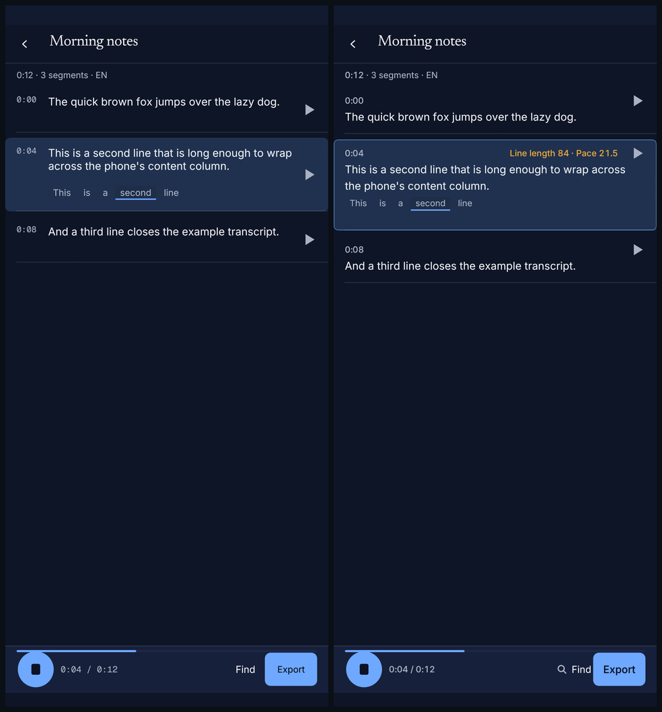
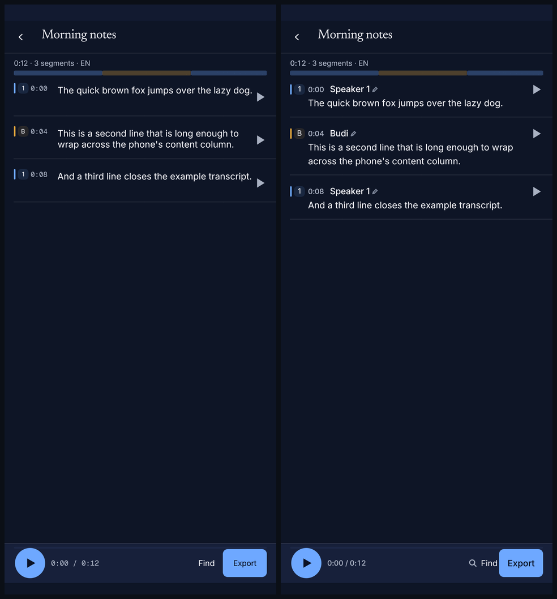
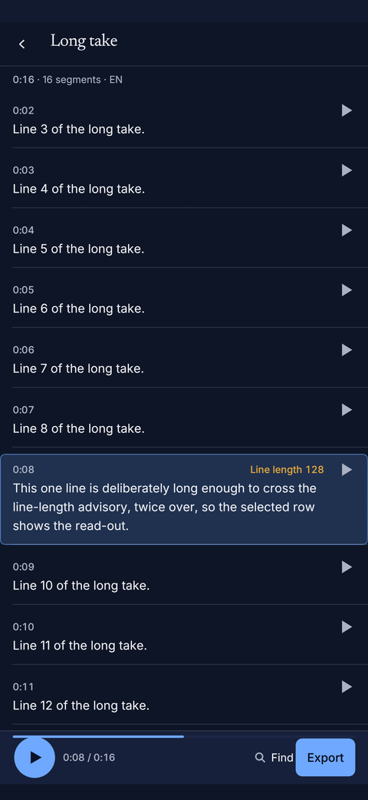
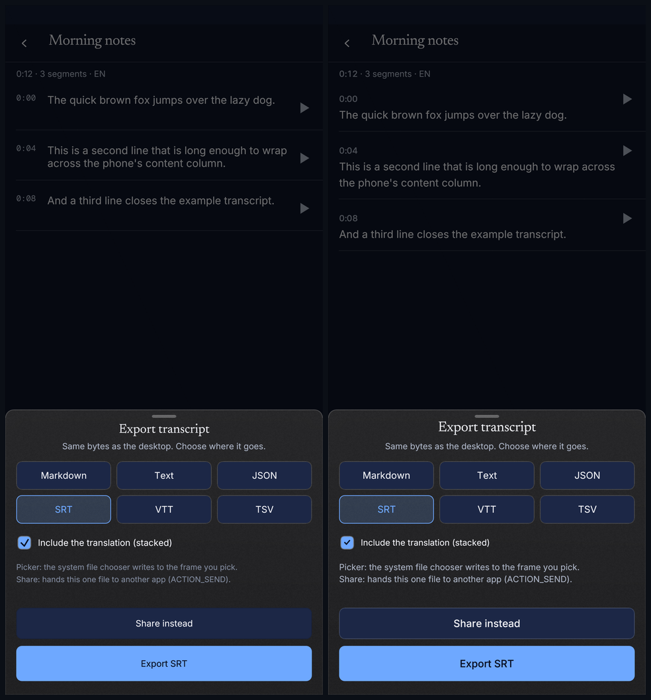
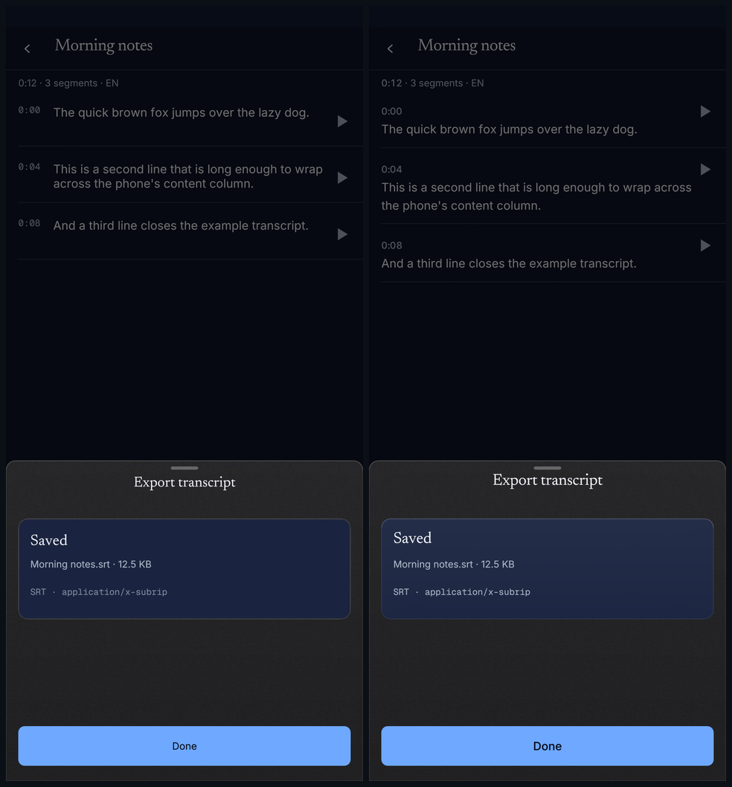
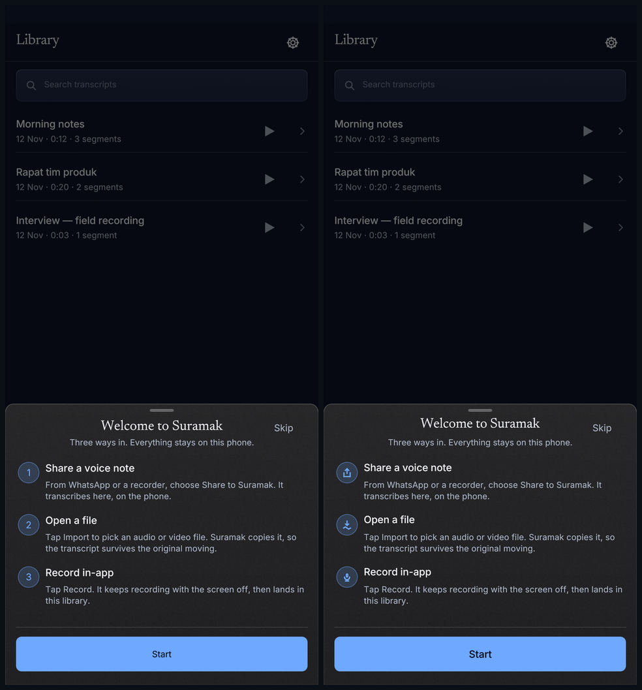
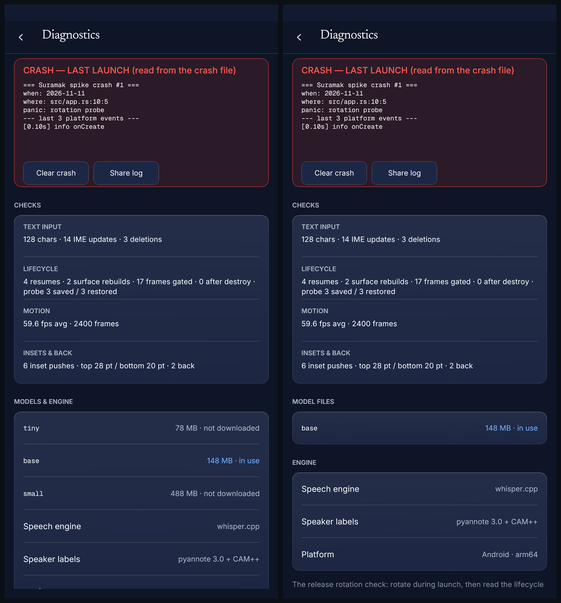

# M20E — the Editor, finished (and the refresh closed)

Slice 5 of 5 of the M20 UI refresh (`docs/WORKORDER-M20E.md`, plan §D). This
is the last slice: the transcript editor, the onboarding sheet and the shared
sheet chrome reach the language the Library (M20C) and Settings (M20D) already
speak, and the refresh gets its closing checklist.

Base: `d29e7ac` (main, 1,230 tests passing). The M20A–D foundations — five
static OFL faces, the type scale, the frost material, the icon kit, the motion
helpers, the redrawn Library and Settings — are **consumed**, not reworked.
No Library or Settings screen code was edited in this slice; `settings.rs` and
its goldens belong to the parallel M20D2 pass.

---

## What changed

### 1 · Transcript body at the type scale

A segment row is now two bands instead of one fixed 66 pt box:

```
0:04   Budi   ✎                                        Line length 84
This is a second line that is long enough to wrap across the
phone's content column, at the body token's 15.5 / 24.
```

* **Header band, 20 pt** — the timecode, the turn's name (row title 15 / −0.1
  / 20), the rename pencil, and the line-length advisory. The timecode itself
  is the **numerals** role (Inter Medium 12.5 / 16), not mono.
* **Body, 15.5 / 24** — laid out through the token's `format()` (tracking 0,
  line height 24) with the content column's full width. The old code passed a
  bare `FontId::proportional(15.5)`, which fell back to Inter's natural row
  height (~19 pt); the token now sets the 24 pt leading the plan specifies.
* **Variable row height** — the body galley is measured before the row is
  allocated, so a three-line segment gets a three-line row instead of painting
  over the divider. The inline editor's row is 160 pt: header + 74 pt field +
  the Save/Cancel pair, unchanged in behaviour.
* **Meta line** — the duration is a numeral on the same tabular grid; the rest
  is the caption token.

The body measure on the 467.7 pt phone viewport is 435 pt (≈ 56 characters at
this size) — the full content column. Splitting the timecode into its own
header band is what buys the body that measure without a 62 pt indent.

### 2 · Fixed-width numerals — the tabular helper

`deck/type_scale.rs` now exports the painter the scale's doc comment promised:

```rust
pub fn tabular_char_advance(ch: char, size: f32) -> Option<f32>
pub fn tabular_width(text: &str, size: f32) -> f32
pub fn paint_tabular(painter, pos, align, text, font, colour) -> f32
```

* Digits use Inter Medium's own `tnum` advance **0.6479 em**; `:` uses
  0.2686 em; `.` uses 0.26 em. Each glyph is centred in its cell, so
  `0:09 → 0:10` is byte-for-byte the same width (the face's default figures
  are proportional — `1` is 0.415 em, `0` is 0.6455 em — which is exactly the
  twitch the plan called out).
* Words around a number are measured proportionally; only the numeric run is
  gridded. That is what lets `Line length 84` sit on the same helper as
  `0:04 / 0:12`.
* The editor uses it for: the meta duration, every row's timecode, the
  transport read-out, and the selected row's line-length/pace advisory.

`a_counting_run_never_changes_width` pins `0:08 = 0:09 = 0:10 = 0:11` and the
one legitimate widening at `10:00`; the integration test repeats the property
at the viewport before writing the scrolled golden.

### 3 · Speaker lane and badges

* The lane stays the shared **8 px** strip (unchanged — it is the same
  `speakers::lane` the desktop draws).
* The badge's numeral/initial is now the **caption** token (Inter Regular
  12.5 / +0.1 / 17) instead of a bare 10.5 pt `FontId`, laid out as a galley so
  the token's tracking lands. The 3 px bar + 18 pt chip geometry is untouched.
* A turn's name appears once, at the row-title token, above the first segment
  of that speaker's run — a real segment header rather than a repeated label.
  A filtered list groups by the visible sequence, which is what the reader
  sees.
* The kit gained a twelfth glyph, `Icon::Pencil` (same 1.75 px round-cap
  stroke as the rest), drawn at 12 pt after the name: the in-place rename
  affordance the badge advertises is now visible, not only spoken.
* Badge click still selects the segment; the shared `speakers::badge` still
  carries the `"<name> — click to rename"` spoken label and its focus ring.

### 4 · `CPL` → **Line length** on the phone

The phone never printed the trade shorthand. This slice gives it a read-out in
the reader's language:

* only the **selected** row carries the advisory (the desktop badges a whole
  column because its reader is a subtitle editor; one quiet read-out is the
  phone's answer);
* `CPL 44` becomes **`Line length 44`**, `CPS 21.3` becomes **`Pace 21.3`**;
* amber (`tokens.warn`), never the record red — this is advice, not a failure;
* thresholds are the documented defaults (37/42, 17/20) from
  `SubtitleLimits::default()`; the phone exposes no threshold setting;
* the numerals in the advisory are on the tabular grid like every other number;
* it is spoken as part of the selected row's label (`Segment 4 · … · Line
  length 84`), so TalkBack hears the same advice the screen shows.

The desktop keeps `CPL` (its own critique has not asked for the rename), and
no desktop editor code was touched.

### 5 · Sheets

Every phone sheet already draws through `chrome::sheet`, which is the
**Sheet plane** (`material::frosted_panel(.., Plane::Sheet)`: opaque sheet
fill, veil, 64×64 grain, 1 px rim, top specular, the one 12 pt / +4 pt / 22 %
float shadow) with the `translateY(100 % → 0)` present, the full-screen scrim,
and Reduce Motion dropping the travel while keeping the fade.

What this slice adds inside them:

* **Buttons take the control kit's pressed spring.** `chrome::action_button`
  now owns its paint: `FAST` down to 0.97 with the tier's active fill, a
  `SPRING_DURATION` spring back, label at the row-title token scaled with the
  body. The hit rect never scales. This covers Export, Share instead, Done,
  Try again, Quit, Cancel, Start and the onboarding action.
* **Format chips** scale on the same spring (`press_frame`), selected keeps
  `accent_tint` + the 1 px accent rim.
* **Titles** use the editorial display token (Newsreader 21 / −0.2 / 27),
  laid out as a job so tracking is real: `Export transcript`, `Quit Suramak?`,
  `Saved` / `Export failed` / `Writing`.
* The export result card moved from the legacy `chrome::card` fill to
  `material::frosted_panel(.., Plane::Card)` — veil + rim, no shadow, because
  it sits in the sheet's content plane.
* The bilingual checkbox's hand-drawn tick is now `Icon::Check`; the sheet's
  disclosure lines use the caption token in `ink_soft` — small helper copy
  stays at the readable ink rather than the faint one.
* The search-close control finally paints the kit's `Close` glyph (it was a
  labelled but invisible 48 pt hit box).

**Scope note.** The phone's modal inventory is export, quit confirm and the
one-time intro; model choice and speaker naming are in-card surfaces on
Settings/the row, not modal sheets, and this slice does not add new sheet
states (that would be a Settings rework). Every sheet the phone has is on the
Sheet plane and the plan's motion.

### 6 · Onboarding

* The hero is the **editorial display** token laid out whole — Newsreader 21 /
  −0.2 / 27 — not a `FontId` that dropped the tracking.
* The three steps use the kit's **Share**, **ImportWave** and **Mic** glyphs
  inside the 30 pt accent rings; the numerals are gone. Copy is unchanged,
  character for character.
* The intro still presents on the Deck spring (its M13g3 curve) and dismisses
  on the fast ease-out; Reduce Motion keeps the fade and removes the rise.
* Start is the shared `action_button`, so it presses with the spring.

### 7 · Motion and idle discipline

* The active segment's highlight **crossfades at `FAST`** (120 ms): the
  selection is solid (a tap is a state), and the *playback* highlight fades in
  and out as the transport enters and leaves a row. No layout moves.
* The karaoke word highlight swapped its `highlight_spring` (240 ms damped
  spring) for the same `FAST` crossfade; the accent bar under the word scales
  with the factor, and Reduce Motion snaps it (the state stays).
* The drawn playhead still uses `motion::seek_ease` — jumps ease, frame-to-
  frame playback is followed exactly.
* Repaints are requested only while a spring/fade/transport is between
  endpoints. `a_settled_screen_with_a_live_job_requests_no_frames` still
  passes; no `request_repaint` was added outside the press/fade helpers.
* The play button itself now presses with the spring (circle + glyph scale,
  hit rect fixed).

---

## Before / after

Left is `d29e7ac` (the previously committed golden); right is this branch.

| Screen | Shot |
|---|---|
| Editor — header bands, 15.5/24 body, tabular timecodes, selected advisory |  |
| Editor — speaker lane, turn names, badges, pencil |  |
| Editor — scrolled, `0:09 → 0:10` in fixed cells (new golden) |  |
| Export sheet — display title, spring buttons, chip spring |  |
| Export result — frosted Card plane, display title |  |
| Onboarding — display hero, kit icons for the three paths |  |
| Diagnostics — re-blessed (M20D2's surface; no M20E code) |  |

`download-progress.png` and `download-resume.png` were re-rendered as the
workorder asks but are **byte-identical** to the base: nothing in this slice
touches the first-run card.

The desktop goldens `tests/ui-desktop/shots/editor-speakers-{light,dark,stale}.png`
were re-blessed because the shared badge now uses the caption token; no
desktop layout changed.

---

## Verification

| Gate | Command | Result |
|---|---|---|
| Formatting | `cargo fmt --all -- --check` | clean (exit 0) |
| Lints (workspace) | `cargo clippy --workspace --all-targets -- -D warnings` | exit 0 |
| NDK check | `cargo ndk -t arm64-v8a --platform 29 check -p suramak-android -p suramak-android-spike` | exit 0 |
| NDK lints | `cargo ndk -t arm64-v8a --platform 29 clippy -p suramak-android -p suramak-android-spike --all-targets -- -D warnings` | exit 0 |
| Phone suite | `cargo test -p suramak-ui --test ui_compact` | **31 passed**, 0 failed |
| UI unit suite | `cargo test -p suramak-ui --lib` | **160 passed**, 0 failed |
| Workspace suite | `cargo test --workspace` | **1,236 passed, 0 failed, 10 ignored** (1,246 listed; exit 0) |
| UI suite after the final a11y label line | `cargo test -p suramak-ui` | exit 0; 160 lib + 31 phone green |

New tests in this slice (+4; the workspace moved 1,230 → 1,236 with the
parallel slice's two unit tests):

* `the_editor_scrolls_with_fixed_width_timecodes` — a 16-segment take, one
  finger swipe, asserts `0:09`/`0:10` have the same tabular width and writes
  `editor-scrolled.png` with the segment-10 control in the visible set.
* `the_advisory_speaks_line_length_not_cpl` — a 48-grapheme line says
  `Line length 48`, never `CPL`/`CPS`; a clean line says nothing; a dense
  multi-line segment says `Pace …`.
* `the_advisory_numerals_are_tabular` — `Line length 44` and `Line length 84`
  are one width.
* `a_counting_run_never_changes_width` (type scale) — the sequential-swap pin
  and the `numeral_run` seam.

The a11y count remains intact: `every_compact_control_carries_a_label_and_a_role`
passes (the editor's new header text is painted inside each row's existing
labelled control; the badge, Save/Cancel, Find, Export and the sheet controls
keep their roles).

### Goldens re-blessed

`editor`, `editor-speakers`, `export-sheet`, `export-written`, `onboarding`,
`download-progress`, `download-resume`, `diagnostics`; new `editor-scrolled`;
desktop `editor-speakers-{light,dark,stale}` (shared badge caption).

---

## The refresh's closing checklist

### Shipped across M20A–E

| Slice | Shipped | Proof |
|---|---|---|
| **M20A — type + motion** | Five static OFL faces (Inter 400/500/600, Newsreader 400, Geist Mono 400; 181 KB) embedded and registered on every target; the plan's type scale as callable tokens; motion tokens and helpers (`FAST`/`BASE`/`SLOW`, press spring, seek ease, sheets, reduce-motion snaps). | `docs/reports/M20a-type-motion.md`; font build byte-check |
| **M20B — material + icons** | `MaterialBackend` (SystemGlass vs PaintedFrost); veil/rim/specular/grain recipe with a two-plane shadow budget; the painted icon kit at one 1.75 px stroke and two sizes. | `docs/reports/M20b-material.md`; material-kit goldens |
| **M20C — Library** | Serif title at the title token; gear in a 44 pt box; frosted search; one shrink-wrapped model banner; type-scaled rows with press motion; Newsreader empty state; floating frosted dock with record-red Record. | `docs/reports/M20c-library.md`; library goldens |
| **M20D — Settings** | One grouped model card with human tiers + mono ids + honest sentences; 8 pt rhythm; accent-tint selection; Quit hidden on Android; Diagnostics as a chevron row and de-jargoned detail; no raw ids on the primary surface. | `docs/reports/M20d-settings.md`; settings/diagnostics goldens; jargon test |
| **M20E — editor, onboarding, sheets** | 15.5/24 body and 15/20 headers; tabular timecodes/advisories/durations; speaker turn headers + caption badges + pencil; `Line length`/`Pace`; sheets on the Sheet plane with spring buttons and display titles; onboarding display hero + kit icons; FAST highlight crossfades; re-blessed goldens + scrolled proof. | this report; 31 phone tests; NDK gate |

The phone now draws every surface it has — Library, editor, Settings,
Diagnostics, sheets, onboarding — from one token ladder, one type scale, one
material, one icon stroke and one motion grammar.

### What remains

1. **Device verification, not host proof.** The 120 Hz playback/recording
   profiling and the Reduce-Motion-toggle smoke from the plan's acceptance
   criteria need a real device or an emulator with KVM; this host has neither.
   The NDK check + clippy gate is what the VPS can prove.
2. **macOS UI build.** `suramak-ui` for `aarch64-apple-darwin` still cannot be
   compiled on this Linux host (`ring`'s C build needs a macOS `cc`). The
   glass capability crate compiles for the target; the UI branch is proven by
   inspection, as in M20B.
3. **Phone speaker rename persistence.** The pencil marks the affordance, but
   the store's `rename_speaker` path is still wired only through the desktop
   editor. A `CompactAction::RenameSpeaker` plus the Android shell handler is
   the next step; no host/engine change was made here.
4. **Desktop `CPL`.** The phone says `Line length`; the desktop editor was not
   part of this slice and keeps its shorthand until its own critique asks for
   the rename.
5. **Modal model/speaker pickers.** Model choice and speaker naming are
   in-card surfaces today. Turning either into a sheet is a Settings flow
   change, deliberately out of M20E's scope (no Settings rework).
6. **Localization and user text size.** Copy is English; Indonesian is tested
   for wrapping, not translated. The scale is fixed point sizes — no dynamic
   type setting yet.

---

## Files

* `crates/suramak-ui/src/deck/compact/editor.rs` — the two-band row, 15.5/24
  body, tabular timecodes/transport/advisory, turn headers, selection +
  playback highlight, spring buttons, display-token sheet titles, frosted
  result card, `Line length`/`Pace` advisory and its unit tests.
* `crates/suramak-ui/src/deck/compact/onboarding.rs` — display-token hero,
  kit icons for the three paths.
* `crates/suramak-ui/src/deck/compact/chrome.rs` — `action_button` now paints
  the control kit's pressed spring (same call sites, no layout change).
* `crates/suramak-ui/src/deck/icons.rs` — `Icon::Pencil` (twelfth glyph) and
  its fit/label coverage.
* `crates/suramak-ui/src/deck/speakers.rs` — badge numeral at the caption
  token.
* `crates/suramak-ui/src/deck/type_scale.rs` — `tabular_char_advance`,
  `tabular_width`, `paint_tabular`, the period cell and the counting-run test.
* `crates/suramak-ui/tests/ui_compact.rs` — the scrolled-editor test and its
  new golden.
* `tests/ui-compact/shots/` — the eight re-blessed goldens + `editor-scrolled`.
* `tests/ui-desktop/shots/editor-speakers-*.png` — re-blessed for the shared
  badge caption.
* `docs/reports/M20e-shots/` — the composites above.

No commit or push, no CI file touched, no new crate, no Library/Settings
rework, no engine change.
