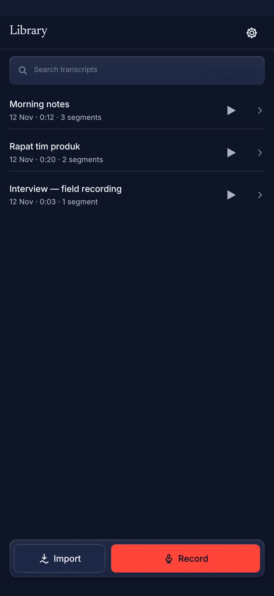
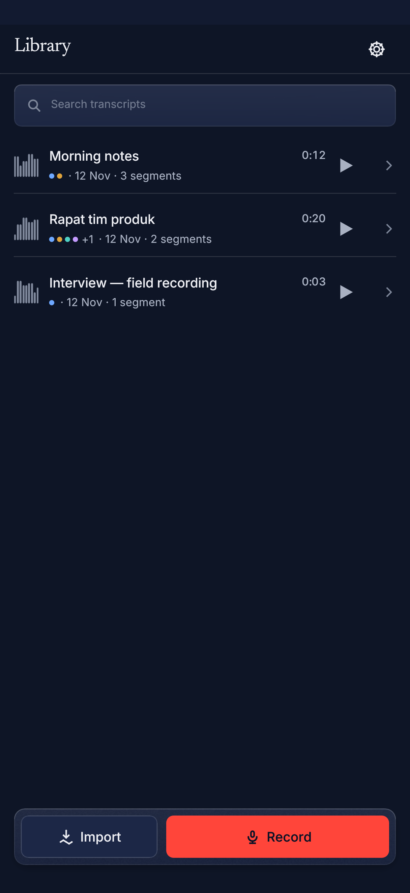
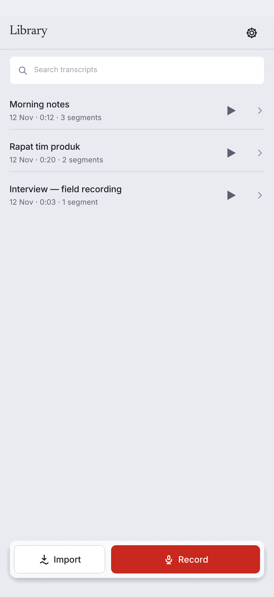
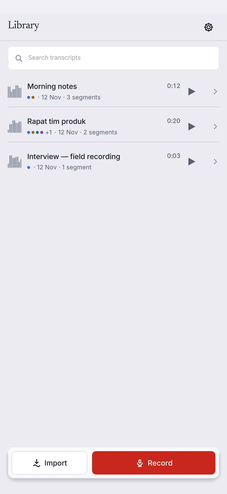
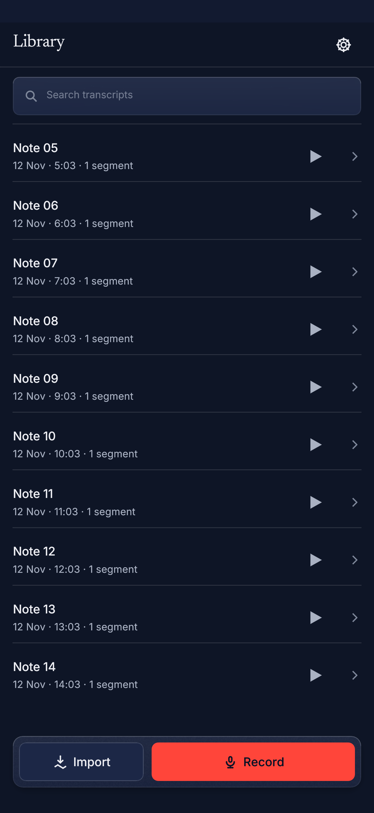
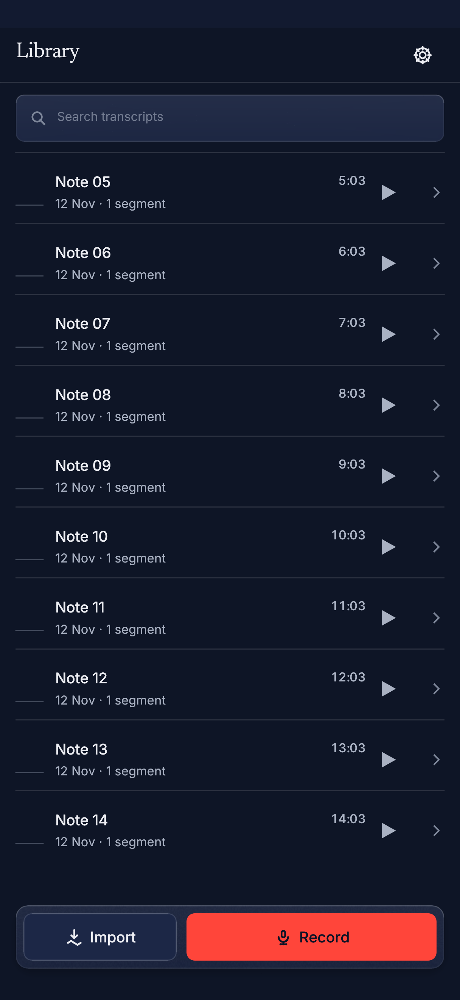
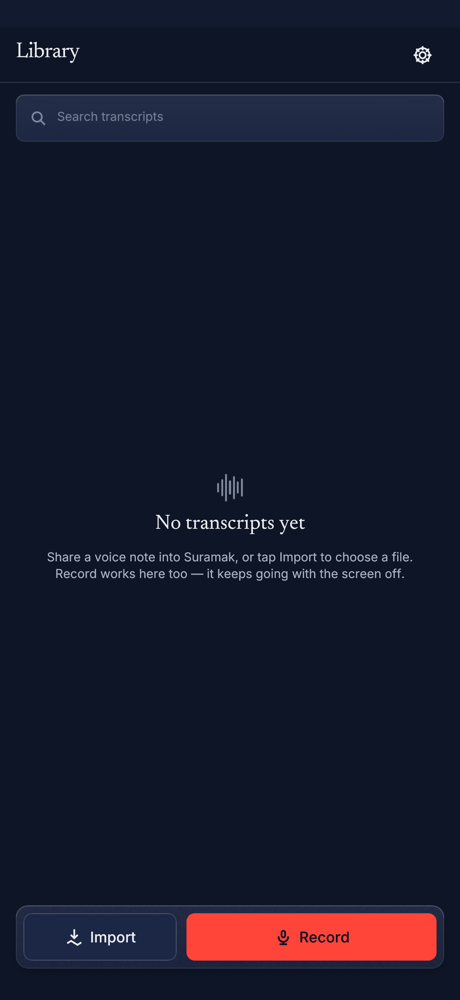
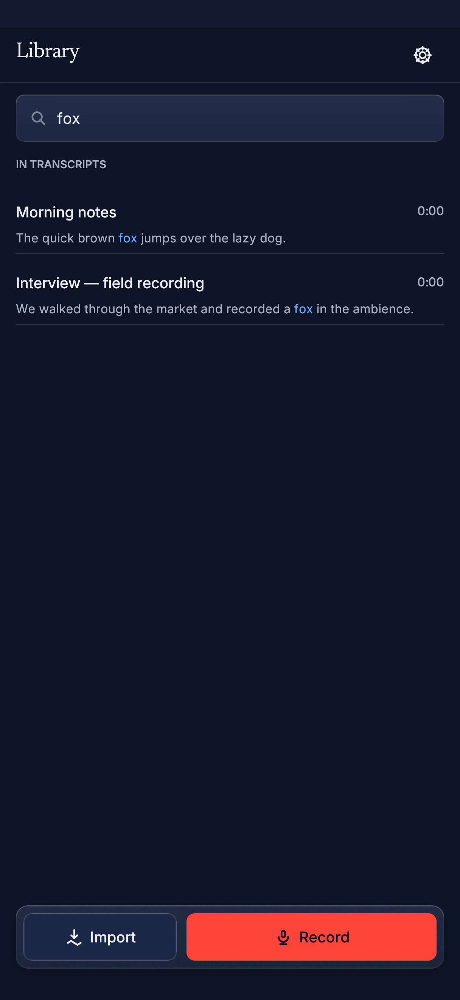

# M22C — library-wide search + richer rows

**Status:** implemented; store gate, UI suite and Android host tests green.
**Tree:** post-`87ec788` (M22A/M22B), schema v9.
**Scope:** an additive FTS5 segment index, `Store::search_segments`, the
compact Library's two-section search with tap-through seek, and the M22C row
anatomy (28 px mini-waveform, speaker pips, tabular duration).

---

## 1 · The audit gate (measured, not guessed)

The workorder's question — *does a phrase search across 200 transcripts stay
under 50 ms on a 2-core box?* — is a test, not a paragraph:
`crates/suramak-core/tests/segment_search_audit.rs`.

Corpus: 200 synthetic transcripts × 40 segments = **8,000 segments**,
**400,000 words**, mixed EN/ID vocabulary, a 19.4 MB database (WAL). Fifty of
the transcripts carry a two-speaker diarization run so the speaker filters are
real. The build goes through the ordinary `insert_transcript` path (the same
index writes a user's library takes).

Twenty queries: single common/mid/rare terms, two quoted phrases, three ANDs,
two prefix queries, speaker-only, speaker+term, speaker+phrase, phrase+term and
two-term mixes. Each is warmed once, then timed with `Instant`:

| Metric | Result |
|---|---|
| p50 | **7.94 ms** |
| p95 | **15.90 ms** |
| max | 16.54 ms |
| mean | 9.46 ms |
| build (200 inserts, index included) | 2.5 s |

**Gate: p95 15.90 ms < 50 ms — pass, on the 2-core VPS.** The assertion is
`p95 < 50.0`; if a future run fails it prints the numbers and fails — the bar
is not lowered.

Per-query table from that run:

| Query | ms | hits |
|---|---:|---:|
| `rapat` | 10.49 | 50 |
| `anggaran` | 15.90 | 50 |
| `mikrofon` | 9.24 | 50 |
| `"anggaran kuartal"` | 7.91 | 50 |
| `"tim desain"` | 7.78 | 50 |
| `jadwal peluncuran` | 8.68 | 50 |
| `laporan hasil diskusi` | 7.65 | 50 |
| `jakarta bandung` | 5.82 | 50 |
| `proyek klien` | 12.92 | 50 |
| `speaker:Budi` | 1.92 | 50 |
| `speaker:Sari rapat` | 6.42 | 50 |
| `speaker:Budi "anggaran kuartal"` | 7.14 | 50 |
| `"rekaman suara" pagi` | 7.79 | 50 |
| `kuartal depan` | 7.94 | 50 |
| `diskusi catatan` | 14.71 | 50 |
| `kantor besok` | 13.10 | 50 |
| `pelunc*` | 11.47 | 50 |
| `desain*` | 16.54 | 50 |
| `"hasil diskusi"` | 7.30 | 50 |
| `speaker:Budi anggaran` | 8.46 | 50 |

**No trigram mirror.** The workorder makes a trigram table conditional on the
audit saying prefix search is too slow. Prefix queries here are 11–17 ms inside
the same 50 ms p95 gate; the ordinary `unicode61` index is enough, so the
second index was deliberately not built.

---

## 2 · The FTS5 schema (exact)

Schema **v9**, additive only. No existing table is dropped, rebuilt or
rewritten.

```sql
-- The indexed content. Only `text` is tokenized; the identity and filter
-- columns are UNINDEXED display data.
CREATE VIRTUAL TABLE IF NOT EXISTS segment_fts USING fts5(
    transcript_id UNINDEXED,
    seg_index     UNINDEXED,
    speaker       UNINDEXED,
    text,
    tokenize = 'unicode61 remove_diacritics 2'
);

-- The document map. One row per indexed segment; `rowid` is the stable address
-- of the FTS row, so an edit is O(log n) instead of a scan of the virtual table.
CREATE TABLE IF NOT EXISTS segment_fts_map (
    rowid         INTEGER PRIMARY KEY,
    transcript_id TEXT NOT NULL,
    seg_index     INTEGER NOT NULL,
    speaker       TEXT NOT NULL DEFAULT '',
    UNIQUE(transcript_id, seg_index)
);
CREATE INDEX IF NOT EXISTS segment_fts_map_transcript
    ON segment_fts_map(transcript_id);

-- The library rows' 28 px mini-waveform: the down-sampled RMS bars of the
-- envelope the editor already computes (little-endian f32, 0..=1).
CREATE TABLE IF NOT EXISTS waveforms (
    transcript_id TEXT PRIMARY KEY REFERENCES transcripts(id) ON DELETE CASCADE,
    bars          BLOB NOT NULL,
    updated_at    TEXT NOT NULL
);
```

Why a map table: FTS5 has no unique key and no cheap "delete by segment". The
map gives every `(transcript, segment)` a stable integer `rowid`; a write is
`upsert map → delete FTS row by rowid → insert FTS row by rowid`. Deleting a
transcript or rebuilding the index walks the map's rowids, so no operation
scans the FTS content table.

### Population

Every path that writes segment text also writes the index, in the same
transaction/savepoint:

* `insert_transcript` / `insert_transcript_with_words` → `write_segments`
* `upsert_segments` (re-transcribe / polish) → `write_segments` + stale-tail delete
* `update_segment_text` (the editor's save)
* `split_segment` / `merge_segments` / `restore_segment_rows` → `replace_rows`
* `delete_transcript`
* speaker changes (`replace_diarization_run`, `rename_speaker`,
  `reassign_turn`, `merge_speakers`, `split_speaker`, `delete_diarization`)
  re-point the stored label, so `speaker:` searches follow a rename without a
  rebuild.

### The one-time rebuild

`Store::open` calls `ensure_segment_index`: if the map/FTS counts disagree with
`segments` (a fresh v8 → v9 upgrade, or an interrupted rebuild), it calls
`rebuild_segment_index`, which:

1. clears the index in one transaction;
2. walks transcripts in `created_at, id` order;
3. **one transaction per transcript** (a crash loses at most one transcript);
4. logs progress every 25 transcripts and a completion line with the totals.

A v8 library therefore becomes searchable on its first open; a library with no
segments is a no-op (`0 == 0`), so the gate never rebuilds on every launch.

---

## 3 · `Store::search_segments`

```rust
pub fn search_segments(&self, query: &str, limit: usize)
    -> Result<Vec<SegmentHit>, SuramakError>;
```

`SegmentHit`: transcript id + title, segment index, speaker, start/end ms,
snippet, `bm25` rank (lower is better; already sorted).

Query language (parsed by `search::segment_query`):

| Input | Meaning |
|---|---|
| `anggaran jadwal` | both terms, AND-ed (FTS5 implicit AND) |
| `"anggaran kuartal"` | one phrase: the two tokens adjacent, in order |
| `speaker:Budi` | literal label filter, case-insensitive |
| `speaker:"Budi Santoso"` | a label with spaces |
| `pelunc*` | explicit prefix on the last token |
| `-`, `…`, `""`, `speaker:` | not a query → empty list, no error |

Quotes, `OR`, `NEAR`, parentheses and `:` inside a term are text, never FTS5
syntax; the expression is assembled only from quoted terms. A speaker-only
query has no `MATCH` expression and is answered from the map, so it returns
every segment by that speaker (rank 0.0, insertion order) instead of failing.

Snippets are built by the existing `search::snippet` window (60 chars each
side, word-boundary snapped, whitespace collapsed, `…` at cut edges), then
`search::bracketed` wraps the located match in `[`/`]`. The Library paints the
inner span in the accent ink and never shows the brackets.

---

## 4 · The Library field (compact profile)

The field now has two sections:

1. **Titles** — `CompactApp::title_matches`, a case-insensitive filter over the
   loaded headers, in the library's newest-first order. These rows keep the
   play affordance.
2. **In transcripts** — the host's `Store::search_segments` hits (debounce-free
   but synchronous on the phone: the store answers in single-digit ms). Each
   row is the transcript title, the timecode on the tabular grid, and the
   ±60-char snippet with the matched span tinted.

Tapping a hit emits `CompactAction::OpenTranscript { id, segment }`; the host
opens the transcript and calls `CompactEditor::reveal_segment(idx)`, which
selects the row (the editor's highlight), parks the playhead on its start and
scrolls it into view on the next frame — the existing seek path, not a second
one. Clearing the field drops the hits and the UI returns to the plain list.

Phone path: `compact_host.rs` gained `{"op":"search","query":…}` and the
snapshot now carries `library_query`, `library_hits` (with segment index,
start, speaker, rank) and `library_waveforms` (how many rows have stored bars).
`open_transcript` accepts the optional `segment` the shell already sent but
the host used to ignore.

---

## 5 · Richer rows

Every library row now draws:

* **28 px mini-waveform** — nine quiet columns from `LibraryRow.waveform`
  (down-sampled RMS bars, `0..=1`). No audio is decoded by the library: the
  desktop's existing peaks job reduces its `Peaks` envelope with
  `Peaks::bars(28)` and stores the result in `waveforms`; the compact host
  reads the whole cache in one query. A row with no stored peaks draws a flat
  baseline — an honest "no data", never invented height.
* **Speaker pips** — up to four, in the Deck's six speaker hues, then `+N`
  (`library::pip_layout` is the tested rule), separated from the date by a
  middle dot.
* **Duration** — right-aligned on the title line in the tabular numeral face,
  so a column of rows does not twitch as `0:09 → 0:10`. The old meta line no
  longer repeats it (`12 Nov · 21 segments`).

The M20C press motion is unchanged: the row still paints through
`chrome::row`'s `press_frame` (the whole body scales to 0.97 with the active
wash) and the pips/waveform/duration are drawn in the scaled visual rect. The
M20C dock-clearance test runs again with every facet populated
(`library-bottom` golden).

---

## 6 · Before / after

All shots are the real 1216 × 2640 phone-viewport rasteriser output.

| Surface | Before | After |
|---|---|---|
| Library, dark |  |  |
| Library, light |  |  |
| Scrolled to the dock |  |  |
| Empty |  |  |
| Search, two sections | — |  |

The before shots are the M20C PNGs as they stood before this slice; the after
shots are regenerated by `cargo test -p suramak-ui --test ui_compact` (the
suite always writes its goldens, so "re-blessed" is the run itself).

---

## 7 · Verification

Store tests (`crates/suramak-core/tests/segment_search.rs`, 11):

* index population on insert; edit re-index; delete clears; structural
  shrink moves/deletes the tail;
* phrase order, AND semantics, speaker filter and rename-follow;
* bracketed ±60-char snippets with ellipses;
* limit + bm25 ordering + empty/garbage queries;
* rebuild when the index is empty on open; v8 → v9 upgrade backfills;
* waveform cache round-trip + cascade.

Audit test: `two_hundred_transcripts_search_under_fifty_milliseconds_at_p95`.

UI suite (`crates/suramak-ui/tests/ui_compact.rs`):
two-section search + tap-through + clear, the `library-search` golden,
`pip_layout` (0/3/4/6/20), facet attachment, and the 14-row dock-clearance
test with waveforms/pips/durations.

Android host tests: `the_library_search_op_returns_ranked_segment_hits`,
`a_search_hit_opens_the_editor_on_its_segment`.

Gates run:

```
cargo fmt --check                      # clean (changed files)
cargo clippy -D warnings               # core, playback, ui, android, spike
cargo test --workspace                 # one full run, baseline 1281 + new tests
cargo ndk -t arm64-v8a check           # suramak-android + suramak-android-spike
cargo ndk -t arm64-v8a clippy          # both Android crates
```

## 8 · Deliberate limits

* **No cloud/semantic search, no new crate** — FTS5 is the bundled SQLite.
* **No editor-search changes** — the per-transcript editor search is untouched;
  this index is Library-wide only.
* **No dock/clearance changes** — the dock geometry and padding are the M20C
  ones; the richer rows are drawn inside the same 64 pt body.
* **Waveforms only where peaks exist.** A phone that has never opened a
  transcript on the desktop has no stored envelope for it, so its row shows
  the flat baseline until the peaks job runs. This is the honest state the
  workorder's "reuse, don't add analysis" asks for; the library path never
  decodes audio.
* **Speaker labels are a projection.** They follow the turns at write time and
  every speaker mutation re-syncs them; a text edit does not move a label
  (the turns are time-anchored).
