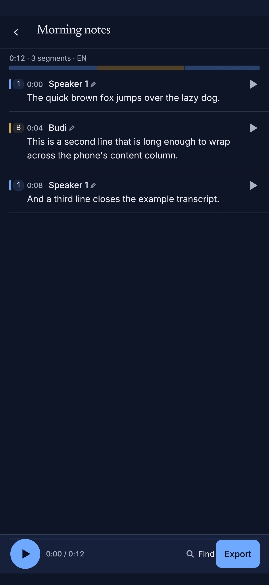
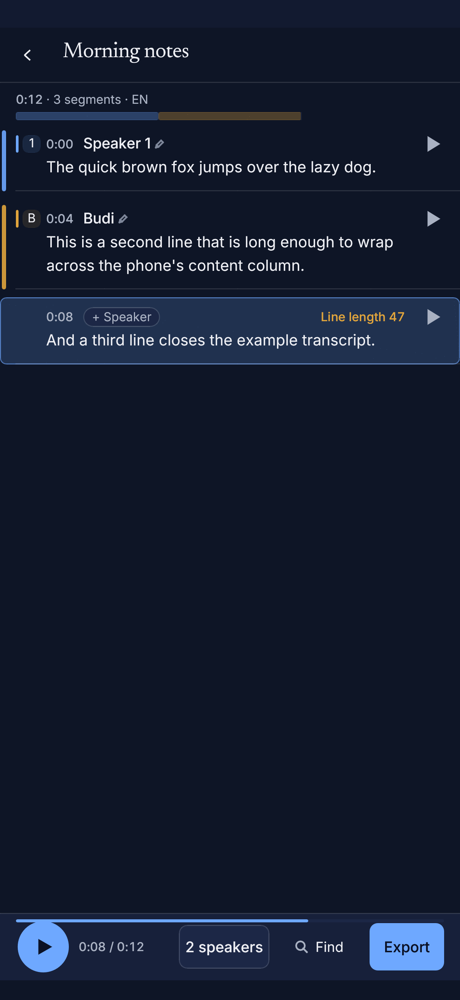
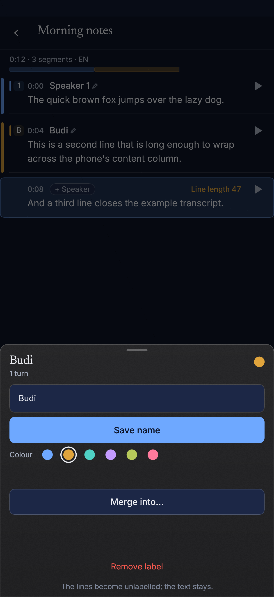
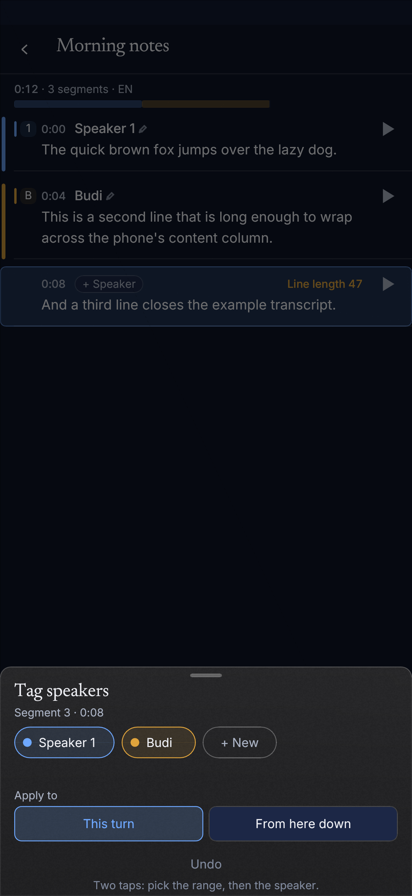
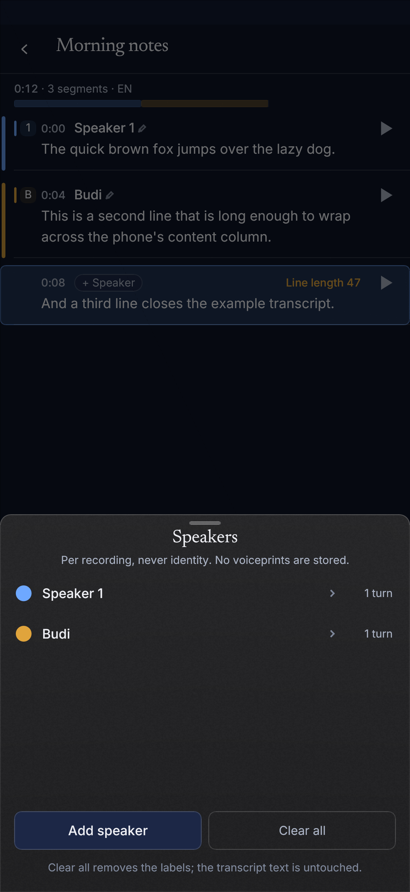
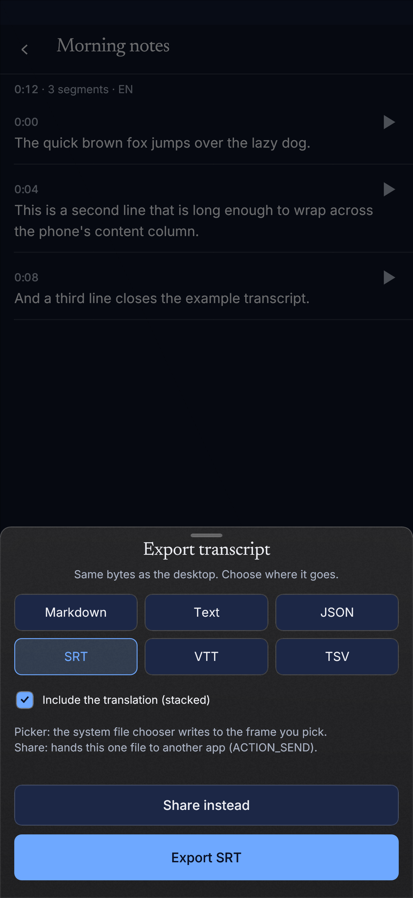
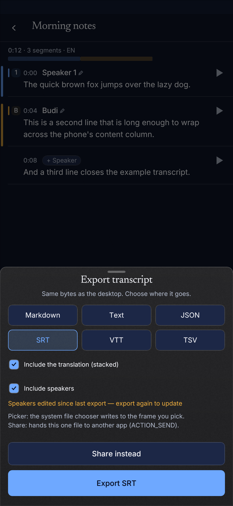
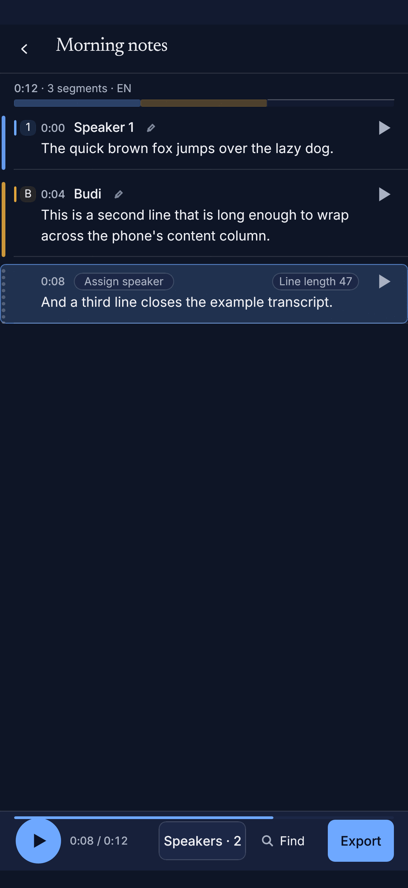
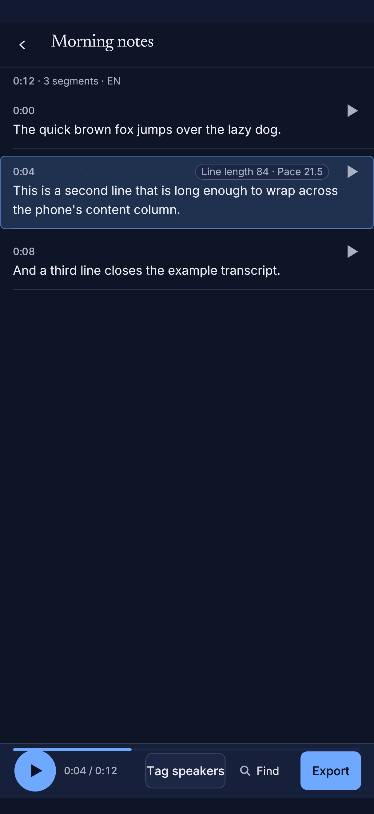

# M23A — manual speaker tagging on the phone, and speakers in exports

Status: complete, verified on the host and cross-compiled for `arm64-v8a`.
Non-goals kept: no diarization engine work, no voiceprint storage of any kind,
nothing cross-file, no new crates, no CI edits.

Owner's ask: *"tag Speaker 1/2/3 for different speaker"*. This slice makes that
true on a phone with no engine at all — the labels are ordinary rows in the
note's own store, the same ones desktop diarization writes. A recording tagged
on the phone is per-recording data; nothing about a voice is retained.

## What shipped

### 1. Store verbs (`suramak-core`)

| Verb | Behaviour | Undo token |
|---|---|---|
| `add_speaker(id)` | next ordinal (`max id + 1`), first unused colour slot (0..6), `Speaker N` label; creates the honest **manual run** anchor when the note was never diarized | `SpeakerSnapshot` (`Add`) |
| `assign_speaker(id, speaker, TimeRange)` | exact reassignment: splits the containing turn at **both** boundaries, fills pauses inside the range, renumbers densely | `SpeakerSnapshot` (`Assign`) |
| `clear_speakers(id)` | deletes every speaker row (turns cascade); the run stays as the empty anchor; Whisper segments are not read or written | `SpeakerSnapshot` (`Clear`) |
| `speakers_edited_at(id)` | `SpeakerEditStamp { revision, edited_at }`, a **monotonic revision** bumped by every speaker verb | — |
| `rename_speaker` / `set_speaker_color` / `merge_speakers` / `split_speaker` | the pre-existing primitives now also return the applied snapshot | one per verb |
| `remove_speaker_label(id, speaker)` | drops one label and its turns (the phone's "Remove label"); default labels renumber, user names do not | `SpeakerSnapshot` (`RemoveLabel`) |
| `restore_speaker_state(id, &state)` | writes a recorded state back verbatim — the Undo action | — |

**Undo is the store's existing pattern, not a second one.** `SpeakerHistory`
mirrors `segment_edit::SegmentHistory` exactly: a bounded `VecDeque` of
`SpeakerSnapshot { before, after }`, depth 20 (`SPEAKER_UNDO_DEPTH`), a push
clears the redo branch, `undo()` pops onto redo, `clear()` on a transcript
switch. A snapshot stores the **real rows** before and after, so undo never
recomputes an inverse (a merge cannot be inverted from ids alone). The Android
host owns one `SpeakerHistory` per open transcript and applies `snapshot.before`
through `restore_speaker_state`.

**Why a "manual run".** `speaker_turns` is anchored to a `diarization_runs` row
(the schema's FK). On a phone with no engine there is no such row, so the first
manual tag inserts one with `segmentation_model = 'manual'`,
`embedding_model = 'manual'`, no sha256, no models, `num_clusters = 0`. It is not
a diarization result and never pretends to be: `DiarizationRun::is_manual()` and
`provenance_line()` say **"manual tags · N speakers"**. No audio is analysed and
no embedding is computed.

Schema **v10** is additive: `speaker_edits(transcript_id, revision, edited_at,
exported_revision, exported_at)`. `revision` is what the honesty note compares,
so a clock change or two edits in one second cannot hide an edit. No existing
table is rebuilt or rewritten.

### 2. Phone UI (`suramak-ui::deck::compact`)

* **Editor.** A 4 px coloured rail down each speaker turn's leading edge (the
  desktop lane stays 8 px), the existing badge, and a muted `+ Speaker` pill on
  every unlabelled row of a labelled transcript. The pill's and the badge's
  tap opens the turn strip for **that** segment. The bottom bar gains a
  **Speakers** button reading `Tag speakers` (nothing labelled) or
  `N speakers` / `1 speaker`.
* **Speaker sheet** (tap a turn's name/badge header): rename field (starts at
  the current label, Save name), six colour dots with a selection ring,
  `Merge into…` (target chips), and the destructive `Remove label` with the
  honest subline *"The lines become unlabelled; the text stays."*
* **Turn strip** (tap `+ Speaker`, a badge, or the pill): a chip per speaker
  plus `+ New`, the `This turn | From here down` scope toggle, and `Undo`
  (enabled only when the host has a snapshot). Two taps assign.
* **Speakers sheet** (bottom-bar button): the list with colour dot, label and
  turn count; `Add speaker` (disabled at the six-slot palette limit);
  `Clear all speakers` armed on the first tap and executed on the second.
  Desktop's Re-run is not present on the phone.
* **Undo toast.** Every applied verb shows `Assigned Budi · Undo` for 6 s above
  the bottom bar (a snackbar above the sheet layer, so Undo stays reachable
  while the sheet is open). One scheduled wake at the deadline clears it; no
  permanent repaint.

All surfaces use the Deck's existing sheet plane (`chrome::sheet_sized`), the
same type scale, the same four-token press springs. Every control is a 44–48 pt
target; nothing needs a long press.

### 3. Exports (`suramak-core::export`)

`Include speakers` is a checkbox in the phone export sheet, offered for SRT,
VTT and Markdown (txt/json/tsv are machine rows and say why they have no
speaker variant). The lines come from the **same projection the editor draws**
(`speaker_for_segments`), so the file cannot disagree with the screen.

```
SRT   Speaker 1: Hello world.
VTT   <v Speaker 1>Hello world.
MD    [00:00:00.000 → 00:00:02.400] **Speaker 1:** Hello world.
```

A renamed speaker exports the user's name (`Budi: …`, `<v Budi>`), never the
default numeral. VTT annotation text is escaped (`R&D <x>` → `<v R&amp;D
&lt;x&gt;>`). An unlabelled row or a silence gap exports **no prefix at all** —
never a fabricated `Speaker ?`. Bilingual SRT/VTT prefix only the primary line
(the translation is the same utterance, not a second speaker).

**Toggle-off is byte-identical to today.** Every speaker serializer is a thin
wrapper over the existing body; `to_srt_with_speakers(t, None)`, `to_vtt_…`,
`to_markdown_…`, and both bilingual variants are asserted equal to the old
functions (and an empty annotation is also the plain bytes).

**Honesty note.** The export sheet shows *"Speakers edited since last export —
export again to update"* when the store's revision is newer than the revision
the last speaker-inclusive export recorded. The stamp is recorded **only after
the platform write is verified** (`export_done` / `export_shared`), never when
the bytes are merely staged. Exported files are snapshots; nothing rewrites them.

## Before / after

| Surface | Before | After |
|---|---|---|
| Phone editor with speakers |  |  |
| Speaker sheet | — |  |
| Turn strip | — |  |
| Speakers sheet | — |  |
| Export sheet |  |  |

The "before" editor shot is the committed `editor-speakers.png` from the
previous head (8 px lane, no rail, no pill, no Speakers button). The "before"
export shot is the previous `export-sheet.png` (no speaker switch). The after
shots are the new goldens: `editor-tag-speakers`, `editor-speaker-sheet`,
`editor-turn-strip`, `editor-speakers-sheet`, `export-sheet` (regenerated).

## Verification

| Gate | Command | Result |
|---|---|---|
| Format | `cargo fmt --all -- --check` | clean |
| Host clippy | `cargo clippy --workspace --all-targets -- -D warnings` | exit 0 |
| Full workspace | `cargo test --workspace` | **1335 passed, 0 failed** (baseline 1312; +23 M23A tests) |
| NDK check | `cargo ndk -t arm64-v8a --platform 29 check -p suramak-android -p suramak-android-spike --locked` | clean |
| NDK clippy | `cargo ndk -t arm64-v8a --platform 29 clippy -p suramak-android -p suramak-android-spike --all-targets -- -D warnings` | exit 0 |

The new tests, by contract:

* **Core:** next-ordinal/first-unused-colour allocation (including a middle
  slot and the six-speaker cap); assign-one-segment splitting **both**
  boundaries; assign-from-here-down; assigning an unlabelled run and filling
  pauses exactly; clear restoring the plain projection with segment rows
  byte-identical; stamp monotonicity and export clearing the note; an undo
  snapshot for **each** verb restoring the exact rows; the manual run carrying
  no model, no sha256 and `num_clusters = 0`.
* **Exports:** SRT/VTT/MD with generic and renamed speakers; VTT annotation
  escaping; unlabelled rows with no prefix; bilingual prefix on the primary
  line; **toggle-off byte parity** for all five serializer pairs.
* **Phone UI:** the two button labels; the pill opening the strip on the right
  segment and the scope toggle changing the action; the Speaker sheet's rename
  (trim, empty refused), colour, merge and remove requests; Clear-all's
  two-tap arm; the 6 s toast and its deadline; the export request carrying the
  speaker flag and dropping it for JSON. Goldens: `editor`, `editor-speakers`,
  `export-sheet`, `editor-tag-speakers`, `editor-speaker-sheet` (+ turn strip
  and speakers sheet).
* **Android host:** add → assign → rename → clear through the JSON ops, undo
  writing the prior rows back, and a speaker export whose stamp is recorded
  only after `export_done` verifies the byte count.

## Limits, stated plainly

* The **desktop export sheet** does not yet show the toggle. The core
  `*_with_speakers` API is host-agnostic and ready; wiring the desktop sheet
  would be a separate UI change (this order scoped the export sheet to the
  phone).
* The Kotlin shim was updated to pass the `speakers` extra (`UiBridge`,
  `ExportWriter`, `MainActivity`), but a Gradle/Android app build is not part of
  this host environment; the Rust NDK check covers the host side only.
* No owner-device pass was run in this environment. The surfaces are reachable
  by thumb and every target is ≥ 44 pt, but the real thumbs-on-glass test is
  still the owner's.
* There is no voiceprint anywhere in this slice: no embeddings are computed,
  stored, compared, or carried across files. The manual run's provenance says
  "manual tags".

## Design review (M23A2)

M23A shipped a working speaker screen. A design review of
`editor-tag-speakers-after.png` at the phone's 1216 × 2640 viewport found four
things that still read as a prototype, plus one inconsistency. M23A2 fixes all
five on the same screen; no store, export, diarization or machine-contract
change rides along.

### 1. The advisory stops looking like debug output

"The line-length advisory" was amber (`warn`) inline text at the header's right
edge. On the selected row it looked like a stray trace label, not product. It is
now a **quiet caption chip**: 20 pt tall, 10 pt radius, `control_fill` with a
`hairline` border, caption type in `ink_soft`, right-aligned before the play
mark. It exists only when the row is selected **and** a metric is outside its
target band; inside the band the header is clean, and an unselected row never
shows it even when it is out of band. The chip is recorded as a caption in the
frame audit (so the suite can prove presence/absence and the helper tone) while
the row's spoken label still carries the reading.

### 2. The timeline strip accounts for unassigned audio

The lane drew only the assigned turns, so a 12.6 s recording whose last label
ended at 8.4 s showed a strip that stopped a third short of the right edge — it
read as truncated. The unlabelled stretches are now computed as the complement
of the turn intervals (clipped to `audio_ms`, overlaps merged) and painted
`panel_faint` with a 1 px `hairline_strong` top edge. The shared turn bands draw
over them, so the strip always spans the whole recording and the silence between
labels is visible as muted tone. A recording with no turns at all paints one
muted, hairlined strip rather than nothing.

### 3. Unassigned rows get a state, not an absence

An untagged row had no rail and only a small pill, so it read as a different
kind of row. It now keeps the 4 px rail column but **dashes it** (4 pt on,
3.5 pt off) in muted ink, beside the `Assign speaker` pill. The same leading
column now says "this row has no speaker yet" instead of "this row has no
treatment"; labelled rows keep their solid speaker-coloured rail.

### 4. The words stop being ambiguous

| Where | M23A | M23A2 |
|---|---|---|
| Row pill | `+ Speaker` | `Assign speaker` |
| Bottom bar | `2 speakers` (a sentence) | `Speakers · 2` (count secondary to the control) |
| Pencil (a11y) | shared with the name | `Rename speaker` |
| Turn header (a11y) | `<name> — rename, colour, merge or remove` | `Speaker options` |

The bottom bar still reads `Tag speakers` before the first label (that state is
a call to action, not a count). The two header affordances are now separate tap
targets with segment-keyed ids — which also removes the **pre-existing duplicate
widget-id overlay** that the old `editor-speakers` golden shipped (two rows of
the same speaker reused one control id). The JSON state's `speaker_button`
string is unchanged, so the M23A machine contract stays byte-compatible.

### 5. Badges stay consistent, and identity is never an icon alone

A default speaker shows its numeral in the badge and its full label
(`Speaker 1`) in the header; a renamed one shows the initial and the name
(`Budi`). The name column used to appear only where the speaker changed, which
left the later rows of a turn with a badge and no name. Every labelled row now
carries the name column, so a reader never has to infer the owner from a
coloured icon; unlabelled rows put the pill in the same column position.

### Shots

| Surface | Before | After |
|---|---|---|
| Tagged editor |  |  |
| Advisory chip | — |  |
| Unassigned rail + pill | — |  |

Golden set re-blessed: `editor`, `editor-speakers`, `editor-tag-speakers`,
`editor-speaker-sheet`, `editor-speakers-sheet`, `editor-turn-strip`,
`editor-scrolled` (the selected long row's chip), and `export-sheet` /
`export-written` (the fixed rows are visible above the sheet). New:
`editor-advisory-chip`, `editor-unassigned-rail`.

### Verification (M23A2)

| Gate | Command | Result |
|---|---|---|
| Format | `cargo fmt --all -- --check` | clean |
| Host clippy | `cargo clippy --workspace --all-targets -- -D warnings` | exit 0 |
| Full workspace | `cargo test --workspace` | **1341 passed, 0 failed** (baseline 1336; +5 M23A2 tests) |
| NDK check | `cargo ndk -t arm64-v8a --platform 29 check -p suramak-android -p suramak-android-spike --locked` | clean |
| NDK clippy | `cargo ndk -t arm64-v8a --platform 29 clippy -p suramak-android -p suramak-android-spike --all-targets -- -D warnings` | exit 0 |

The new tests, by contract:

* **Unit (editor):** the chip's condition (selected **and** out of band; inside
  the band → absent; unselected long row → absent; Pace gated the same way); the
  unlabelled spans are the complement of the turns (tail, head + tail, overlap
  merge, whole recording, clip past the audio, zero-length audio); the unassigned
  rail is a dashed 4 pt column, never a solid band.
* **Phone UI:** the selected long row paints `Line length …` in `ink_soft` at
  caption size (never `warn`), and a clean selected row paints no advisory at
  all; the unassigned row renders ≥ 4 dashes in the rail column while the
  labelled rows keep solid rails, and the pill reads `Assign speaker`; the
  bottom-bar control reads `Speakers · N`; every row of a multi-row turn carries
  `Speaker options` + `Rename speaker` and paints the full `Speaker 1` label.

### One unrelated fix the build required

The v0.5.0 release commit bumped `FileVersion`/`ProductVersion` in
`packaging/windows/suramak.rc` but left `FILEVERSION 0,4,3,0`; the UI crate's
build script asserts that literal on every target, so a fresh tree could not
build. The numeric lines were corrected to `0,5,0,0`. No CI or packaging
behaviour changed.
